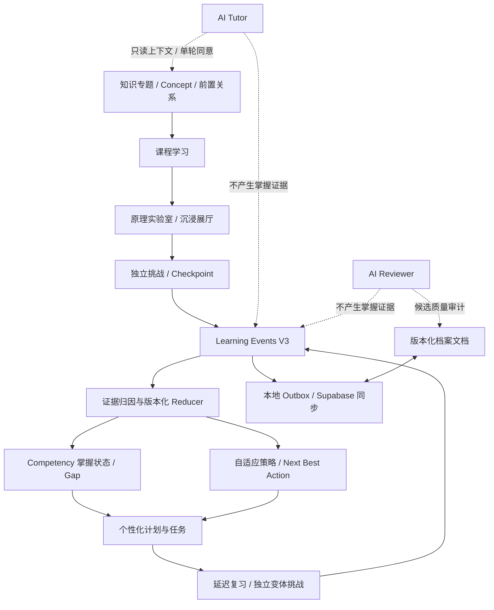
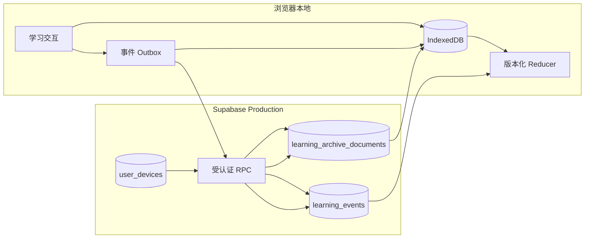

# KNOWVERSE 4.1 — 功能依赖与数据流关系图

## 1. 产品主链路

## 2. 关键业务模块依赖

| 上游 | 下游 | 契约 / 关联 ID | 风险边界 |
|---|---|---|---|
| `content/knowledge.json` | 专题课程 / 页面 | topic ID、canonical route | 内容页面存在不代表掌握图完整 |
| `content/learning-map.json` | Concept / Competency / Gap / planner | topicId、competencyId、prerequisites、gapId | 当前仅 4 个专题正式映射 |
| `content/works.json` | Lab / Gallery / Puzzle | workId、knowledge_ids、competencyIds、checkpointId | 作品注册信息必须与实际入口一致 |
| `content/challenges.json` | Challenge Engine | challengeId、stepId、competencyIds | 仅完成挑战不能绕过正式评分证据 |
| `content/learning-checkpoints.json` | Checkpoint Engine | checkpointId、workId、topicId、competencyId、gapId | 需验证错误选项和 Gap 映射准确性 |
| `content/review-assessments.json` | Review Engine | assessmentId、competencyId、topicId、gapIds、sourceHref | 必须独立变体，防止记忆答案伪装掌握 |
| Learning UI / engines | `learning_events` | event_id、event_type、topic_id、payload、causation_event_ids | 事实追加，不直接写可信 mastery 分数 |
| Event reducer | Gap / mastery / strategy | reducerVersion、competencyId、evidence refs | 必须可重放、可解释、可回归 |
| Goal / Planner / Task manager | `learning_archive_documents` | goal / plan / task IDs、revision、status | 文档 CAS 与事件事实不可混为一谈 |
| Review / Challenge | Learning Events + Review documents | source gap、variant、attempt、outcome | 重复提交与刷新必须幂等 |
| Agent | Learning tools / Provider / Agent documents | tool allowlist、consent、session IDs | 只读或受限写入；不得直接授予掌握 |
| Practice Reviewer | append-only quality audit | candidateId、candidateHash、recordType、approval | 审核候选不是学习者掌握证据 |
| Local repository | Supabase RPC | deviceId、deviceSeq、userSeq、document revision | 生产同步不能与 staging 测试混用 |

## 3. 持久化边界

- `learning_events`：不可变事实，包含用户、设备、设备序号、用户序号、事件类型、时间、payload hash 与显式因果引用。
- `learning_archive_documents`：可版本化状态文档，包含 revision / document sequence / payload hash；适用于 goals、plans、tasks、review sessions、Agent session 等。
- mastery、confidence、Gap 与 next-best-action 是派生读模型，必须追溯到事件证据和 reducer 版本。
- AI Tutor 反思、阅读完成、候选题生成、Reviewer 评分不能自动转成正式掌握证据。

## 4. 核心闭环断点审计优先级

1. **事件契约**：从答题 / 实验完成入口追踪至 IndexedDB Outbox、RPC 校验、生产行，再追踪 reducer 输入。
2. **因果关联**：验证 attempt → gap identified → plan/task → review → reattempt → gap resolved 的引用链。
3. **状态派生**：确认同一事件序列在刷新、重放、重复同步后得到同一掌握状态。
4. **复习独立性**：同一道题重复提交不得提高掌握度；必须通过独立变体。
5. **计划可解释性**：每项任务显示来源 Gap / Competency、先修约束、目标时间和策略理由。
6. **云端边界**：使用隔离 staging 账户验收真实 RPC；Production 只读检查，不写测试事件。
