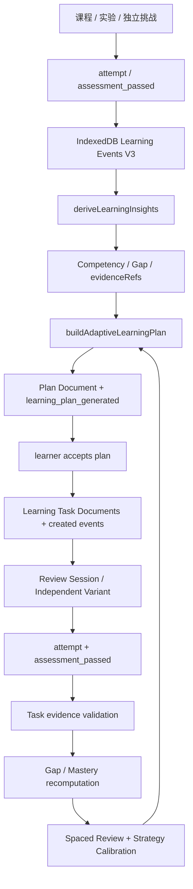

# KNOWVERSE 4.1 — 学习数据流与持久化审计

## 1. 事实数据和派生状态

- 学习事件：`assets/js/learning-event-schema.mjs` 定义 schema v3、event ID、时间戳、因果引用、Gap observation ID 与引用上限；`assets/js/learning-progress.mjs` 负责规范化和 reducer。
- 本地存储：`assets/js/backend/local-event-store.mjs` 与 `assets/js/backend/learning-repository.mjs`；学习事实追加写入，状态文档按 revision 做 CAS；repository commit 将 events 与 documents 放入同一 IndexedDB 事务。
- 云端：Production `public.learning_events` 保存事件，`public.learning_archive_documents` 保存版本化文档；`user_devices`、`user_sync_state`、`user_document_sync_state` 为设备序列和同步状态服务。
- 事实与投影必须分离：掌握度 / confidence / active gaps / spaced repetition / learner profile / proactive projection 是从事件和图谱派生的读模型，不是可任意写入的真值。

## 2. 核心因果链

## 3. 本次发现的因果引用缺口与修复

### 修复前

1. `deriveLearningInsights` 的 active Gap 只返回 Gap ID、计数、时间和变体，不携带失败观察事件 ID。
2. `buildAdaptiveLearningPlan` 为 Gap 生成 repair action 时只携带 gapId，来源失败事件 ID 丢失。
3. `mapPlanActionToTask` 没有保存 sourceEvidenceRefs。
4. `planEvent` 将所有计划事件写成 `topicId=unclassified`、`competencyIds=[]`，没有 topicIds / targetGapEventIds / causationEventIds；函数参数 `extra` 被忽略。
5. 接受计划时的 `learning_task_created` event 没有复制任务来源证据。

### 修复后

- Active Gap 输出 `sourceEvidenceRefs`（真实未解决失败 observation event IDs）。
- Plan action 保存来源证据；一般行动也保留其相关成功测评证据引用。
- Plan document / task document 保存来源证据引用。
- Plan lifecycle events 保留 topicIds、competencyIds、sourceEvidenceRefs、causationEventIds、targetGapEventIds；单专题计划设置 topicId，多专题计划保留 `unclassified` 主 topic 并同时记录完整 topicIds。
- `planEvent` 正确合并调用者传入的 actor / supersededByPlanId / reason 等元数据。
- Task created event 复制 sourceEvidenceRefs；对 Gap 修复任务同时设置 targetGapEventIds。
- 历史 Production event 不回写、不迁移、不伪造引用；新逻辑仅对未来事件生效。历史计划文档仍保留原有 action topic / competency 关系，可供人工审计。

## 4. 生产数据只读快照（2026-11-14 审计时）

- `learning_events`：8 条。
- `learning_archive_documents`：6 条（按审计查询快照；软删除行按表查询方式可能影响可见数量）。
- `user_devices`：2 条。
- `practice_candidate_quality_records`：0 条。
- `profiles`、`user_sync_state`、`user_document_sync_state`：本次查询均为 0 行。
- 生产已有 Promise 专题的 attempt / assessment_passed / review_started / plan_generated 等事件，但样本很小；不能用 8 条事件证明所有用户流程都已真实跑通。
- 生产 learning plan 文档包含 2 个 action，覆盖 2 个 topic 和 2 个 competency；plan head 指向 proposed plan，没有 active plan。没有 learning task documents / learning_task_created 事件，因此该真实账户尚不能作为“计划接受→任务执行→复习→再次验证”的完整生产闭环证据。
- Production 的 `learning_plan_generated` 历史事件 `topic_id=unclassified`，但其 plan 文档动作跨两个专题；对多专题全局计划使用 unclassified 主 topic 是合理的，历史事件缺少 topicIds / competencyIds 则是可审计性不足。本次代码修复不会改写历史记录。
- Production 有两条 review_session 记录；仅凭记录数不能判断会话是否有效完成，必须按状态与事件链解释。

## 5. Supabase / RPC / Edge Function

- Production 项目 ref 在每次查询中显式指定为 `sxcpareycpokcyroufww`；本地 CLI link 指向 staging，禁止混用。
- Production 有 13 条 migration；本地有 13 个 SQL migration 文件。Phase N 同名 migration 时间戳不同（本地 `20261113041514`，生产 `20261113153515`）；需要继续核对 SQL 定义等价性，不能仅凭名称认定无 drift。
- `learning-agent` Edge Function：ACTIVE，version 10，`verify_jwt=true`；`practice-quality-review`：ACTIVE，version 4，`verify_jwt=true`。
- 生产 Agent function source 明确：缺少 `AI_PROVIDER_API_KEY` 或 `AI_PROVIDER_MODEL` 时返回 `503 AI_PROVIDER_NOT_CONFIGURED`。Function active 不等于模型真实可用；本次无法读取 secret 值，也没有执行已授权用户的真实模型请求，Provider 可用性标记为未验证。
- Reviewer 需要确定性校验、独立审查、匹配 hash 的 pass、独立人工批准；Edge Function ACTIVE 不等于 Reviewer Provider 已验证。
- 不修改 Auth、OAuth、生产 secret、生产 schema 或生产数据。

## 6. 测试边界

- 本地 IndexedDB fake-indexeddb 测试证明事件与文档 repository 的事务语义、幂等、CAS 和 reducer 可重放。
- 浏览器 E2E 使用隔离 context / 合成学习者，不写入 Production。
- Staging hosted tests 必须显式使用 staging project 与独立测试账户；本次没有对 Production 执行学习事件写入。
- 本阶段不调整跨浏览器自动同步频率、标签页互等或调度机制。
