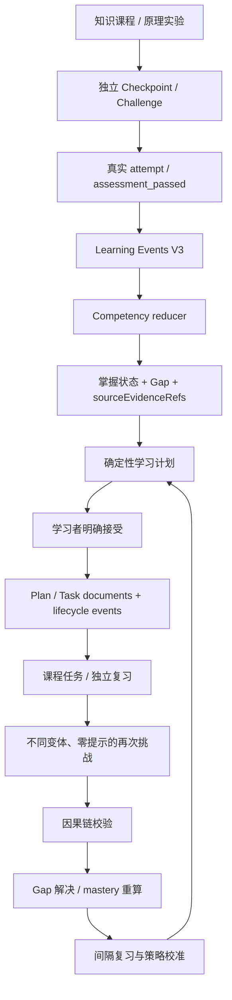

# KNOWVERSE 4.1 — 真实学习闭环设计与证据契约

## 1. 闭环原则

KNOWVERSE 的学习闭环以可重放的用户操作事实为基础，不以页面访问、AI 对话、阅读时长或任务状态直接推断掌握。

## 2. 证据等级

| 事件 / 行为 | 可用于行为画像 | 可用于掌握度 | 说明 |
|---|---:|---:|---|
| page_viewed / 阅读打开 | 是 | 否 | 只能说明访问 |
| learning_task_in_progress / paused | 是 | 否 | 只说明任务状态 |
| learning_task_completed（lesson/read） | 是 | 否 | 课程阅读确认不是测评 |
| Tutor 对话 / 私有反思 | 是（单独档案） | 否 | 不写正式 mastery evidence |
| practice candidate 生成 / AI Reviewer | 否（内容治理） | 否 | 不属于学习者测评 |
| attempt（错误） | 是 | 作为 Gap 观察 | 需绑定 competency / gap / variant |
| assessment_passed | 是 | 是（需满足独立性规则） | 需绑定正式 assessment、competency、variant、hint count 与 session |
| review_started | 是 | 否 | 必须保留 targetGapEventIds 与因果起点 |
| 无提示、不同变体 assessment_passed | 是 | 是 | 经过完整因果链验证后可解决对应 Gap |

## 3. ID 关联契约

- `event.id`：单条学习事实的稳定唯一 ID。
- `competencyIds`：能力图谱中的正式能力 ID。
- `gapId`：知识误区分类，不是某次失败的唯一 ID。
- `gapObservationId`：具体失败观察事件 ID。
- `sourceEvidenceRefs`：计划 / 任务来源证据集合；必须指向真实 event IDs。
- `targetGapEventIds`：本次复习明确针对的失败观察 ID。
- `causationEventIds`：事件的直接因果前序，例如 review_started → attempt → assessment_passed。
- `planId` / `taskId` / `sessionId`：跨文档和事件串联计划、任务、测评 session。
- `variantId`：独立题目或检查点变体；掌握验证不能重复使用同一变体伪装独立性。

## 4. 计划生成规则

- Planner 由 reducer 派生的 active Gap、Competency 状态、先修约束、复习排程、目标和用户偏好生成行动。
- Repair action 必须带 Gap 来源失败观察 ID；普通 review / validation action 带相关测评 evidence IDs。
- 多专题计划允许主 `topicId=unclassified`，但必须同时保存完整 `topicIds` 和 `competencyIds`，不得丢失范围信息。
- `learning_plan_generated` 只是提案，不代表学习者接受；只有明确接受才创建 active plan 和 tasks。
- 每个 task 必须保留 planId、actionId、topicId、competencyId、gapId、sourceEvidenceRefs、目标资源和 evidencePolicy。
- 阅读任务完成只能确认执行；不能直接提升 mastery。

## 5. 复习和掌握更新规则

- 复习任务从具体 active Gap 或 due competency 创建。
- Review session 绑定 taskId / planId / competencyId / gapId / variantId。
- 错误答案产生 attempt 与 Gap observation；提示操作单独记账。
- 复习成功需要零提示、不同于原失败变体，并具有 review_started、attempt、assessment_passed 的完整因果链。
- Task orchestrator 在 complete 前再次验证所有未解决失败观察是否有独立通过证据；不满足时拒绝完成。
- reducer 从事件重算 Gap 与 mastery；历史事实不被 UI 直接覆盖。
- 间隔复习使用真实证据时间计算 dueAt；浏览器虚拟时钟只用于隔离测试，不代表真实用户已经等待了 30 天。

## 6. 自适应策略

- 策略输入是独立能力表现、提示依赖、跨变体结果、延迟回忆和近期证据质量。
- 规则引擎区分 recommendation、execution、independent ability、delayed outcome 和 feedback。
- 策略变化必须保留 strategyDecisionId、algorithmVersion、before/after、reason、evidenceRefs 与 confidence。
- 证据不足时维持 cold-start / general strategy，不得凭浏览、Agent 消息或单次答题过度个性化。
- 新策略通过后续无提示独立挑战、延迟复习和跨题型迁移验证，不把策略推荐本身视为学习成功。

## 7. AI 边界

- AI Tutor 只获得学习者明确选择的摘录和受限上下文；不执行写工具，不产生 mastery evidence。
- Learning Agent 可以请求只读数据，并提出需学习者明确确认的写操作建议；模型输出不能自动执行。
- AI Reviewer 是内容质量流程；只有确定性验证、独立审查、匹配内容 hash 的 pass 和人工批准后，候选题才可进入发布流程。
- AI Provider 未完成真实调用验证时，UI 必须明确区分规则模式和真实模型模式。
