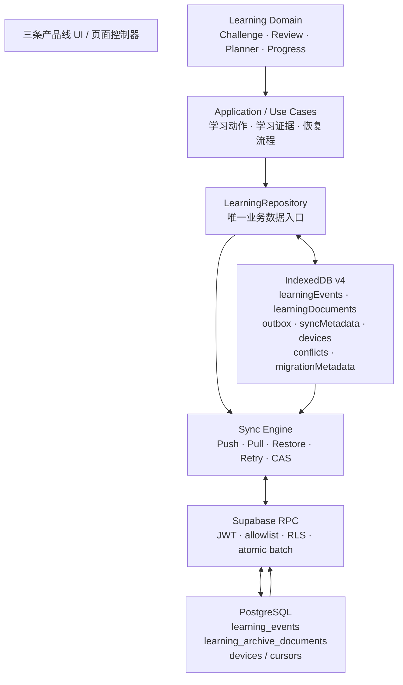

# KNOWVERSE Phase D：统一学习数据架构

版本：Phase D · 2026-11-02

## 决策摘要

Phase D 将 Phase C 的 Local-First 过渡存储升级为明确的双层持久化：

- **IndexedDB v4** 是当前设备完整的本地学习数据库。事件日志、可恢复状态文档、Outbox、同步游标、设备信息、冲突和迁移标记均由它管理。
- **Supabase PostgreSQL** 是已同步数据的云端权威存储。追加式事件与版本化状态文档分开建模，由受 RLS 保护的 RPC 同步。
- **LearningRepository** 是学习业务访问本地和云端数据的唯一入口；领域模块不直接操作 IndexedDB、LocalStorage 或 Supabase。
- **Sync Engine** 独立负责 Push、Pull、Restore、CAS 冲突、重试、串行化和跨标签页租约。

尚未同步的数据是当前设备的有效学习数据，不会被云端恢复覆盖。只有服务端确认的事件和文档才被标记为已同步。

## 架构总览

## 分层职责

| 层 | 负责 | 不负责 |
|---|---|---|
| UI | 呈现状态、收集操作、展示明确的保存/同步失败 | 拼 SQL、操作 IDB、决定云端版本 |
| Domain | 挑战规则、复习生命周期、学习事件语义、掌握度推导 | 选择物理数据库 |
| Application | 协调一次学习动作所需的事件和当前文档 | 执行多个不受控的写入 |
| LearningRepository | 账户边界、读写语义、原子提交、业务 API | 具体 UI 行为 |
| IndexedDB Adapter | 本地事务、索引、Outbox、迁移、租约 | 领域规则 |
| Sync Engine | 批量上传、增量拉取、云端恢复、冲突处理和重试 | 计算掌握度 |
| Supabase | 账户隔离、约束、幂等、服务端事务和游标 | 客户端界面 |

## 两类核心数据

### Learning Events

事件是追加式事实：发生过什么、发生时间、来源、知识能力点、因果关系和评估结果。稳定 event ID 用于本地与云端幂等；相同 ID 的内容不可变。错误观察、复习因果和目标 gap 均有显式引用，不能靠客户端墙上时钟猜测。

事件只追加、不通过“当前状态快照”替代历史。掌握度和薄弱点是事件驱动的可解释投影，不是客户端随意写入的独立事实。

### Learning Documents

文档是可恢复的当前现场，不是历史日志。Phase D 当前支持：

- `challenge_progress`
- `review_session`
- `plan_preferences`

每份文档有账户归属、localRevision、base/cloud revision、payload hash、更新时间、dirty 状态和冲突标志。删除采用 tombstone，同步后仍可跨设备传播删除语义。

## 本地事务

一次学习动作产生的事件、当前状态文档和 Outbox 必须在同一个 IndexedDB transaction 中提交。文档写入支持 expectedLocalRevision；多标签页对同一现场基于同一旧版本写入时，后提交者收到本地 CAS 错误，必须重新读取，不会静默覆盖。

浏览器突然关闭时，已提交事务完整存在；未完成事务由 IndexedDB 回滚。配额错误、事务中断、升级阻塞必须显示为失败，不能报成功。

## 云端事务与账户安全

`sync_commit_learning_batch` 在一个 PostgreSQL RPC 事务中组合事件追加和文档 CAS。文档发生 CAS 冲突时整个批次回滚，事件也不会被确认。客户端只在 RPC 成功返回后清理 Outbox/标记文档同步。

RPC 使用 `SECURITY INVOKER`、空 `search_path`、完整 schema 限定、显式身份和 allowlist 检查；执行权限仅授予 authenticated。RLS 是数据隔离主体，不能由前端过滤代替。

Pull RPC 再次核验当前 JWT 是否仍等于客户端预期账户，防止账号切换竞态污染本地账户游标。Repository 在每次领域 API 调用时校验活跃认证账户和本地数据库绑定；发现 A/B 账户不一致即阻止读写。初次登录时，尚未绑定的现有本地数据会被原子绑定到当前已登录账户。

## 数据恢复与迁移

Phase C envelope 通过一次性迁移器转入 IndexedDB：严格解析、SHA-256 源指纹、结构验证、原子导入、回读核验、迁移标记核验，全部成功后才清理 allowlist 内的旧学习键。Promise Realm 的独立旧游戏存档也先安全并入 envelope 再迁移。Auth/PKCE 键不在迁移清单中。

v1 IndexedDB 的 Outbox、设备元数据和档案文档会在 IDB schema upgrade transaction 中复制到 canonical stores；复制请求成功后才删除旧 stores。v2 到 v3 只删除已完成前向复制的旧 stores。数据库升级失败会中断升级事务，保留旧数据库。

## 未来 Agent 能力

事件日志提供可追溯的学习事实，文档提供可恢复的活动现场，知识地图定义 competency 与 prerequisite，掌握度由事件 reducer 推导。未来 AI Agent 可在受控只读查询与明确写入工具的边界内生成候选计划；学习证据与掌握度裁决仍由确定性领域规则管理，AI 不直接写“已掌握”结论。

## 主要实现入口

- `assets/js/learning-event-schema.mjs`
- `assets/js/backend/learning-repository.mjs`
- `assets/js/backend/local-event-store.mjs`
- `assets/js/backend/phase-c-migration.mjs`
- `assets/js/backend/sync-engine.mjs`
- `supabase/migrations/20261102114344_phase_d_atomic_learning_batch.sql`
- `scripts/verify-local-learning-database.mjs`
- `scripts/e2e-cross-device-archive.mjs`

## 状态和限制

该架构的本地事务、迁移、Repository、同步 RPC 契约和浏览器模拟设备测试由自动化验证。自动化 WebKit iPhone viewport 不等于实体 iPhone Safari 验收；真实设备 OAuth、多账户真实 JWT 隔离和现场网络切换仍需要在 checklist 中记录实测结果。
