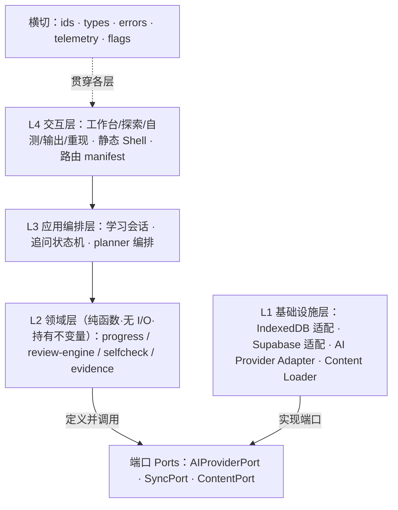

# KNOWVERSE 推翻重做 · 项目交付方案

> 生成日期：2026-11-20 ｜ 编排：全栈架构交付专家团（主理人 高屋建）｜ 状态：**新定位已获用户认可（2026-11-20）；未提交、未 push**
> 锁定：本次为**产品推翻重做**（非 IA 重设计）。地基冻结、上层重做（D2）；北极星 EUU（D5）。
> 输入：8 位成员专项产出（产品策略 / 系统架构 / AI 链路 / 数据建模 / 前端 IA / 后端契约 / 部署运维 / 测试验收）+ 主理人裁决 D1–D13。
> 所有【待确认】为信息缺口，**未编造数字或事实**；指标均标注口径与状态（PASS / FAIL / NOT RUN / BLOCKED）。

---

## 1. 一句话定义与成功标准

**定义**：把 KNOWVERSE 从"证据驱动学习闭环"重做为一个**问题驱动的个人理解工作台**——以"我当下要搞懂的一个真问题"为原子单位，系统隐形，核心循环为「探索 → 用自己的话输出 → AI 对话式追问/挑错 → 轻量自测 → 沉淀笔记 → 间隔重现」。

**成功标准（北极星）**：每周**有效理解单元（EUU）**数。EUU = 一次完成「探索 → 输出 → 挑错 → 轻量自测通过」且留下 ≥1 条可复用沉淀的理解单元；**页面访问、停留、动画通关、AI 自评一律不计入**。

**辅助标准**（各痛点主指标）：
| 痛点 | 主指标 | 目标（口径） |
|---|---|---|
| 架构腐化 | 越界依赖数 / 受影响模块数 | 0 / 局部化（CI 架构守卫） |
| AI 链路稳定性 | AI 任务失败率；AI 不可用核心流程完成率 | ≤2%（**仅 Staging 合成账户口径**）；100% |
| 产品 IA/体验 | Time to First Insight；首屏行动清单呈现 | ≤60s（内控 ≤30s）；≤3s 且无 JS 可见 |
| 测试与交付成本 | 脚本数 / 全量 CI 时长；核心校验覆盖率 | 显著下降；**100% 保留不得放宽** |

---

## 2. 需求范围

### 2.1 MVP（本期必做）

1. **今日工作台**：行动清单驱动的首屏（取代知识目录首页），≤3 步行动、60s 内到首个理解点。
2. **单领域做透**：Promise / JS 运行时（存量实验与内容最成熟，素材可复用）。【待确认】首选领域。
3. **可交互探索 + 轻量自测**：复用存量 lab/works 为素材；仅满足评估契约的通过才记理解证据（诚实性内核）。
4. **AI 对话式追问/挑错 + 确定性兜底**：AI 不可用时核心流程 100% 可完成；严格 11 字段练习生成**本期下线**（D1）。
5. **版本化与回退**：feature flag + 新旧并存绞杀；develop 单分支 push 即生产部署下的可控回退。
6. **架构骨架完整**：Provider 抽象 / 能力契约 / schema 单一事实源 / 可观测 / 分层 / CI 分层门禁（范围定义见 D10）。

### 2.2 后续迭代（Should / Could）

- Should：E3 结构化输出与知识对象关联、E4 基于真实事件的间隔重现、双领域复制验证。
- Could：多模态私人资料、语音/视频辅导（明确后置）。

### 2.3 本期不做（Out of Scope）

- 三主线全量铺开 / 12 专题平推；精密掌握度/置信度/Gap 仪表盘；115 评估注册表的前置依赖。
- 生产数据库写入 / Auth / Secrets / Edge Function 配置变更（硬约束）。
- 跨浏览器同步频率 / 标签页等待 / 调度机制改动（AGENTS.md 冻结范围）。
- 为通过测试放宽任何校验（含 `validPasses` 因果链、严格 schema）。
- 真正的逻辑删除与物理清理（旧内容/路由保留可回退）。

---

## 3. 系统架构与技术选型

### 3.1 架构方针

**地基冻结、上层绞杀（Strangler）、护栏先行、特性开关可控回退。**

- **冻结地基**：同步 CAS 协议与冲突语义、RLS / `auth.uid()`、`learning_events` append-only、canonical ID 单一事实源、Concept/Competency/Evidence 三分不合并、严格校验、生产只读。
- **可重做上层**：前端模块分层与边界、AI Provider 与链路、scripts/ 工具链与 CI、产品 IA 与体验形态。

### 3.2 分层架构

依赖单向：交互 → 应用 → 领域；基础设施实现端口；**禁止领域反向依赖或循环依赖**（CI 架构守卫强制）。

### 3.3 候选架构风格权衡（ATAM 摘要）

| 候选 | 收益 | 代价 | 结论 |
|---|---|---|---|
| **A. 本地优先模块化分层单体**（选） | 离线可用、可控迁移、部署极简、冻结同步边界不动 | 需模块搬迁纪律 | **推荐** |
| B. 服务端中心化 BFF + 瘦 SPA | AI/数据一致性强控制 | 牺牲离线、与同步冻结冲突、迁移面大 | 否决 |
| C. 插件化微内核 | 可插拔、扩展上限高 | 单人项目过度设计、治理成本高 | 否决 |

关键权衡点：严格 schema 校验 ↑可靠性 ↔ 若模型能力不足 ↓功能可用性（KV41-011 正落此处）——**只能换 Provider，不放宽校验**。

### 3.4 技术选型对照表

| 领域 | 主选 | 被否决备选 | 否决理由 | 阶段 |
|---|---|---|---|---|
| 模块/类型 | **原生 ESM + JSDoc 类型注释** | TS + Vite | MVP 阶段需生成根 package.json/lock，触碰 AGENTS.md「npm 是 pnpm shim、勿污染工作区」硬约束；现有 ~40 模块已是 ESM，静态 shell 预渲染已满足 3s/60s | D3→**D8 收口**：MVP 用原生 ESM，TS+Vite 降 P5 演进预备（默认不启动） |
| UI 层 | Web Components / 极简轻量方案 | React | 静态站点 + 本地优先，React 生态与产物过重 | 【待确认】开发者框架偏好 |
| 状态管理 | 领域纯函数 + 轻量 observable store | Redux 类重型 | 样板多、与"领域无 I/O"冲突 | — |
| AI Provider | Provider 抽象（converse / suggest 双端口）+ 能力契约 | 绑定单一厂商 SDK | KV41-011 根因即"模型能力≠校验契约"，单绑定无法切换 | 骨架必做 |
| Edge 运行时 | 保留 Supabase Edge Functions（Deno） | 独立 Node 服务 | 迁移成本高、丢失 Supabase 原生集成、扩大冻结面 | D9：逻辑边界用 `_shared/`，**不新增 Edge Function** |
| 校验层 | schema 领域层单一事实源、版本化、前后端与 Edge 共享 | 手写散落校验 | 易漂移、易诱发放宽 | 必做 |
| 本地存储 | 保留 IndexedDB v4（仅类型化封装） | 迁 SQLite-WASM / Dexie 改造 | 与同步冻结冲突 | D6：MVP Note 纯本地不跨端 |
| 测试 | 分层金字塔 + 架构守卫 | 维持 95 散落脚本 | 维护成本高、职责混杂 | 分组不删测试（D11） |
| CI | 7 分层 job + 汇聚门禁 + 缓存 | 维持 60+ 线性步骤 | 时长随规模线性膨胀 | P0 重构 |

---

## 4. 数据库设计摘要

（严格遵守 D2 冻结；新增均 additive-first；D6 决定 MVP Note 纯本地）

| 实体 | 层 | 性质 | 说明 |
|---|---|---|---|
| **EUUDefinition** | 公共（content 注册表新增） | 版本化只读 | 理解单元定义，`anchors[]` 锚定 Concept/Competency/Evidence（**不合并**），`prerequisite_euus` 沿用 `prerequisite_of` 语义，`calibration_assessment_ids` 复用高质量题作校准素材 |
| **Note（E3）** | 个人权威（IndexedDB only，MVP） | 本地优先 | 稳定 `note_id`、主锚点 `about_canonical_id`、`source_event_ids` 诚实性溯源、`content` 按 note_type 的 JSON Schema 校验；D6：MVP 不建 Postgres 表、不跨端 |
| **EUUState** | 个人派生（IndexedDB） | 可重建投影 | 粗粒度 `mastery_band`（unseen/exploring/familiar/solid），**不暴露精密分数**；带 `reducer_version`，可由事件全量重建，不参与 CAS/RLS |
| **ReviewItem** | 个人派生（IndexedDB） | 可重建投影 | `due_at` / `interval_days` / `last_event_id`（真实事件可追溯）/ `scheduler_version`；snooze 以 append-only 事件记录后再派生 |
| CanonicalIDMap | 公共（ids 单一源派生） | 版本化 | 旧 ID → 新 ID + `redirect_path`，新旧连接键，保证回退可追溯；canonical ID 仍只在 ids 一处定义 |
| searchEntry | 派生构建产物 | 禁止手改 | 每条带 `body_hash = hash(源 body)`，CI 校验"提交 == 重建"（根治 KV20-002） |
| learning_event | 冻结 | append-only | 结构语义完全不变 |

**关键设计判断**：把新数据按"权威 vs 派生"切开。只有 Note 是用户产出的权威个人数据；EUUState / ReviewItem 全是 `learning_events` 的派生投影，本地可重建、不写权威库、不产生冲突面——这是"证据机制降级为后台轻量机制"的正确落点。

> 【待确认·高】Note 跨端（additive 新表 + 同模式 `auth.uid()=owner_id` RLS）延至 P4+ 增强，须用户授权生产迁移后再做。

---

## 5. 前后端与智能体实现要点

### 5.1 智能体链路（根治 KV41-011）

**根因**：模型能力契约与严格校验契约不匹配（模型不保证约束解码到严格 schema，校验不放宽 → 稳定 502 AI_INVALID_OUTPUT）。

**关键裁决**：D1 下线用户可见的严格练习生成 → 失败模式改变而非消失；D7 能力契约按用途分两类：
| 能力 | 用途 | 红线 |
|---|---|---|
| `converse` | 对话式追问/挑错（自然语言，本期主用途） | 流式 / 可配超时 / token 预算 / 内容安全；**不要求 strict schema** |
| `suggest` | 笔记结构化候选（若启用） | `strict_json_schema=true`、嵌套/enum/required/additionalProperties:false **准入红线** |

**编排拓扑**：单 Agent + 状态机（不上多 Agent、不上完全自治 ReAct）。追问有硬轮次上限 N（建议 3，【待确认】），每轮必须推进，无进展直接进自测。

**AI 不可用的确定性兜底**（保证核心流程 100%）：兜底 = 从确定性代码（薄弱点/Gap 派生）生成的**提示清单**，非缓存/模板内容（避免陈旧知识）。兜底事件打 `fallback=true`，核心循环不中断。

**Provider 抽象**：领域层只依赖 `AIProviderPort { converse, suggest }`（`Result<T,E>` 显式错误，不用异常穿透）；Adapter 出口单一前置校验；能力契约测试为接入红线；有界重试（suggest 2–3 次 / converse 1–2 次，【待确认】）重跑同一 validator；按 provider/model 熔断切换（须先验能力契约）；换模型需新 secret 时由有权限方配置，**不读取/不输出 secret**。

**掌握事实彻底去模型化**：理解证据、掌握度、置信度、Gap、计划派生全部确定性代码；AI 只做追问者/挑错者/笔记候选，**不写任何掌握事实**。

### 5.2 前端

- **三根本转变**：首页 = 今日工作台（非知识目录）；一级结构 = 以真问题为中心的单线程工作流（三主线降为组件）；精密仪表盘 → append-only 证据 + ≤3 步行动。
- **路由 manifest 单一事实源**：`ROUTE_MANIFEST` 登记 `canonicalId / newPath / legacyPaths`，构建期生成重定向 stub + 运行时消费；旧路径渐进绞杀，MVP 只映射 Promise 领域。
- **组件体系**：LabShell 统一外壳 + 适配器复用现有 ~40 引擎模块（**不重写实验逻辑**）；TraceBadge 三重区分教学 trace 与真实执行（诚实性）；InquiryChat 覆盖流式/中断/重试/降级四态。
- **无障碍/性能**：WCAG 2.1 AA；LCP≤2.5s、INP≤200ms、CLS≤0.1、首屏 JS≤50KB gzip。

### 5.3 后端 / Edge Function

- **四逻辑边界、两物理函数**（D9 不新增函数）：编排状态机 / Provider 适配 / 协议校验网关 收进 `supabase/functions/_shared/`，两个入口 `learning-agent` / `practice-quality-review` 保持薄；Reviewer 保持物理独立且强制不同模型。
- **双轨契约**：`version:1` 保留旧 IA；新增 `version:2` capability 化（`conversational_inquire` / `conversational_challenge` / `note_structure_suggest`），由 flag 控制；未知版本 `SCHEMA_VERSION_UNSUPPORTED`，不静默降级。
- **降级响应**：Provider 未配置/超时/限流/校验失败且重试用尽 → `conversational_*` 与 suggest 返回 `HTTP 200 + status:'degraded' + fallback:true + 确定性提示`；**这是"不采用 AI 输出"，不是"接受未校验输出"**。mutation 建议与 Reviewer 始终 fail-closed。
- **错误码**：canonical + 旧码别名并行一版（两函数现有命名风格不一，【待确认】是否统一）。
- **冻结边界**：RPC `sync_push_learning_events`、质量审查 append-only 系列、`config.toml` 的 `verify_jwt=true`、RLS/secrets 全部不可改。Edge Function **禁止**写 `learning_events`、写掌握事实、自动发布。

---

## 6. 里程碑与排期（含人力假设）

**人力假设**：个人开发者，分阶段推进；每个 P 阶段以"可独立交付 + 可独立回退"为完成定义。以下为**依赖关系与优先级**，非承诺工期。【待确认：各阶段实际投入时间】

| 阶段 | 目标 | 可独立交付物 | 依赖 | 回退点 |
|---|---|---|---|---|
| **P0 地基/骨架** | 护栏先行、不碰业务行为 | feature flag 基础设施 + CI 7 分层重构 + tooling 骨架 + 冻结 guard + 基线快照 | 无 | 起始 tag（无功能变更） |
| **P1 IA + 首屏（E1）** | 新工作台与首解路径 | 今日工作台、路由 manifest、新旧并存绞杀、五态、性能预算 | P0 | flag 切旧 + P1 tag |
| **P2 核心循环（E2/E4）+ AI 契约** | 证据诚实性与 AI 骨架 | 探索/自测、间隔重现、Provider 抽象 + 能力契约 + 骨架、KV41-010/011 回归 | P1 | flag + P2 commit |
| **P3 AI 追问与降级（E3）** | 对话式追问 + 100% 兜底 | InquiryChat、状态机、熔断、离线评测集（Staging 合成账户验证 ≤2%） | P2 | mock 全失败仍 100% 到终态 |
| **P4 灰度绞杀（E5）+ 边界** | 双轨稳定、回退无污染 | v1/v2 双轨、错误码别名、flag 矩阵、search 强制模式、冻结护栏全开 | P3 | flag 回退 + P4 commit |
| **P5 演进预备（默认不启动）** | TS+Vite 演进预备 | parity 回归、bundle 预算 | P0–P4 全绿且明确授权 | 回退原生 ESM 产物 |

**关键路径**：P0 → P1 → P2 → P3 → P4；P5 为可选支路。每阶段在 develop 打 tag 记录 commit SHA 作为回退点，回退优先 flag 切换，其次 git revert。

---

## 7. 部署上线方案

- **环境三层**：本地（单测/规则校验/PG17/Playwright）→ Staging Supabase `ypthoicwrfsblaidllyy`（Edge 真实部署、RLS/CAS、AI 合成账户、search 观察模式）→ 生产 Pages（只读探活）/ 生产 Supabase（严格只读）。单分支无 staging 站点，靠 feature flag 在同一部署内做逻辑隔离。
- **头号陷阱护栏**：`supabase/.temp/linked-project.json` 指向 Staging；所有 CLI 强制显式 `--project-ref`，CI 加 **ref 守卫**（缺 ref 或命中生产 ref 且未标 `PROD_AUTHORIZED` 即失败）。
- **CI 结构**：7 分层 job（static-checks / unit-tests / data-contracts / derived-art / e2e / build）+ quality-gate 汇聚门禁；build 依赖 derived-art 产出的 search.json；双构建哈希比对验证可复现；规则 ID 清单迁移前后 diff 防覆盖遗漏。
- **发布**：develop push 自动部署（维持现状）；生产 Supabase 迁移**必须人工授权**，绝不进 CI 自动执行；高危 flag 切换建议 `workflow_dispatch` 手动触发【待确认】。
- **回退 runbook**：flag 可控异常 → 改 flag 默认值 push（分钟级，首选）；代码级缺陷 → git revert 到阶段 tag；DB 异常 → additive 设计下切读回旧字段，down 迁移须授权。生产只读验证：核心路由 200 + 资源哈希一致 + Supabase 只读查询（不写、不跑 AI）。

---

## 8. 测试与验收清单

### 8.1 分层金字塔（不删测试，D11）

L0 架构守卫（越界依赖=0）→ L1 单元（核心模块覆盖、分支≥80%【待确认】）→ L2 契约（converse/suggest、v1/v2、错误码、flag 矩阵）→ L3 集成（PG17 replay 13/13、sync isolation/RLS、派生重建）→ L4 E2E（Playwright 本地 + Staging 合成账户）；横切：静态校验 + 构建可复现。

**D1 冲突处理**：严格练习生成下线后，相关测试标记 `FROZEN/NOT RUN（能力下线）`，**不删不跳过**，保留 strict schema 红线断言作为 suggest 守卫，置于独立 CI job（非 PR 必过）。

### 8.2 E1–E5 关键验收（节选）

| 用例 | Given/When → Then | 优先级 |
|---|---|---|
| E1-P1 | 冷启动无缓存 → 首屏 ≤3s 清单可见（无 JS 也可见）、首解 ≤60s、性能预算达标 | P0 |
| E2-P1 | 自测符合契约 → 仅通过才 append 证据；访问/停留/AI 自评不产生证据 | P0 |
| E2-N1 | 契约失败 → 不写证据、重跑同一 validator、不降级 | P0 |
| E3-N1 | mock 全 AI 不可用 → 确定性兜底、可跳过、核心循环 100% 到证据裁决 | P0 |
| E4-N1 | 复用档案历史已解决 gap → 其他 task 已解决不要求重验，本 task 不得自我解决，validPasses 不放宽（KV41-010） | P0 |
| E5-N1 | flag 回退 → 旧路径完整、无双写残留、生产只读断言成立 | P0 |

### 8.3 AI 链路测试（全部离线 mock，不调用生产/不读 secret）

- 能力契约测试；**strict schema 红线测试**（变异输入断言 validator 拒绝 + 源码字段/约束快照 hash 未下调，精确覆盖 KV41-011 真实失败输出）；有界重试/熔断测试（每次重跑同一 validator）；**兜底完成率 100% 测试**（mock 全失败，≥100 条种子场景 100% 到达终态，样本/种子可复现）；越权/注入测试（越权率/代写率=0）。

### 8.4 冻结边界回归

同步 CAS（冲突整批回滚）、RLS（跨 `auth.uid()` 0 行）、append-only（UPDATE/DELETE 被拒）、canonical ID（唯一、引用完整、无环）、三分结构、严格校验、`config.toml`/RPC/secrets 冻结 diff guard、KV41-010 因果链、KV41-011 不放宽 schema——全部只用本地合成库/PG17/Staging 合成账户，**生产只读**。

### 8.5 状态规范与生产边界

状态 ∈ {PASS, FAIL, NOT RUN, BLOCKED}；NOT RUN 说明原因，BLOCKED 写明前置条件；均不计入通过率，禁止 FAIL 改标 BLOCKED。

**BLOCKED（如实标注，不得记通过）**：实体 iPhone Safari、第二物理设备同步、生产真实学习闭环、生产 AI secrets（KV41-004/007）、生产 Phase N 迁移、真实模型 practice 生成（KV41-011，MVP 记 `NOT RUN（能力下线）`）。

### 8.6 缺陷分级与放行

P0（数据污染/越权/伪造掌握/冻结破坏/核心中断）≤24h 且一票否决；P1（Must 失败/性能不达标/schema 被放宽）≤3 天且 No-Go；P2 ≤1 迭代备案放行；P3 排期。**Go**：P0/P1=0、E1–E5 全绿、冻结全绿、构建可复现、生产只读确认、BLOCKED 如实标注。

---

## 9. 风险清单与应对

| 风险 | 概率 | 影响 | 应对 |
|---|---|---|---|
| `linked-project.json` 误操作 Staging/生产 | 中 | 高 | CLI 强制显式 `--project-ref`；CI ref 守卫；runbook 醒目提示 |
| 单分支无 staging 缓冲，坏提交直达生产 | 高 | 高 | feature flag 绞杀 + quality-gate + 阶段回退点 |
| strict schema 红线被"为过测"放宽（KV41-011 重演） | 中 | 极高 | 红线快照 hash + 代码评审 + 冻结 guard；合法路径只有换模型/converse 降级 |
| 脚本分组/合并误删测试、覆盖下降 | 中 | 高 | 台账+基线快照，逐批 git mv，断言数下降即 CI 失败 |
| Staging 合成账户污染致 E2E 假失败 | 高 | 中 | 每轮清理+备份；断言不依赖 planner 内容假设 |
| AI 兜底未覆盖全部异常态 | 中 | 高 | mock 全失败矩阵 + ≥100 场景 100% 断言，种子可复现 |
| ≤2% 指标被误写成生产已达成 | 中 | 高 | 报告模板硬编码"仅 Staging 合成账户口径；生产 NOT RUN" |
| flag 回退双写/残留污染 | 中 | 高 | E5 Given/When/Then + 生产只读断言 |
| 依赖重构引入循环依赖 | 中 | 中 | L0 架构守卫 CI 门禁，越界依赖数=0 |
| 生产迁移与只读冲突 | 低 | 高 | additive-first、dry-run、解耦、单独授权 |
| 回滚窗口极短 | 中 | 高 | flag 秒切首选、保留旧 Edge 代码一版、阶段 tag |
| BLOCKED 项被当作已验收 | 中 | 高 | 状态枚举 + 前置说明 + 审计复核 |

---

## 10. 决策与权衡说明（D1–D13）

| ID | 决策 | 理由 / 被否决方案 |
|---|---|---|
| D1 | MVP 下线严格 11 字段练习生成；AI 改对话式追问 + 确定性兜底；不放宽校验 | KV41-011 真实模型连续 502、ROI 为负；**被否决**：放宽 schema 换通过 |
| D2 | 地基冻结（同步 CAS/RLS/append-only/canonical ID/三分/严格校验/生产只读），只推翻产品形态与上层 | 推翻工程地基会违反硬约束并摧毁确定性资产 |
| D3→D8 | 前端 MVP 用**原生 ESM + JSDoc**；TS+Vite 降 P5 演进预备（默认不启动） | 被否决（MVP）：TS+Vite 需生成根 package.json，触碰 AGENTS.md；分层架构与构建工具无关 |
| D4 | feature flag + 新旧并存绞杀为必选护栏 | develop 单分支 push 即生产部署，回退窗口极短 |
| D5 | 北极星 = 每周 EUU，继承诚实性底线 | 访问/停留/通关/AI 自评不计入 |
| D6 | MVP Note 纯本地 IndexedDB，不建 Postgres 表/RLS/跨端 | 跨端非 MVP 必需；生产迁移须授权；零新冲突面 |
| D7 | 能力契约按用途分两类：converse 不要求 strict schema；suggest 要求红线 | D1 后"换模型"降为常规运维；不放宽底线不变 |
| D9 | 逻辑边界用 `_shared/` 模块，**不新增 Edge Function** | config.toml 冻结，新增函数需改配置踩红线 |
| D10 | "全栈完整交付" = 架构骨架完整 + 业务收窄 Promise 单领域；生产 AI 未配置，≤2% 仅 Staging 口径 | 避免把骨架完整误读为全业务铺开；避免指标虚报 |
| D11 | D1 下线能力与"不删测试"冲突 → 标 `FROZEN/NOT RUN` 但不删，保留红线守卫 | 与 AGENTS.md 测试底线一致 |
| D12 | 阶段边界统一 P0–P5（见 §6） | 消除成员间口径不一 |
| D13 | 细项【待确认】归清单，标责任角色与决策时点，不拍脑袋定值 | 不编造数字 |

---

## 11. 待确认清单（需你决策）

| # | 事项 | 责任角色 | 决策时点 |
|---|---|---|---|
| 1 | ~~新定位"问题驱动理解工作台"是否认可~~ | 用户 | ✅ **已认可（2026-11-20）**；本次锁定为推翻重做，非 IA 重设计 |
| 2 | MVP 首选领域 Promise / JS 运行时是否认可 | 用户 + 产品 | P1 前 |
| 3 | 生产 AI secrets 是否配置、是否授权真实模型验收费用 | 用户 | P3 前 |
| 4 | Note 跨端（additive 表 + 同模式 RLS）是否授权生产迁移 | 用户 | P4 前 |
| 5 | 开发者 UI 框架偏好（Web Components / Svelte / 极简） | 用户 | P1 前 |
| 6 | note_type 枚举与 E3 content JSON Schema 具体形态 | 产品 + 数据 | P2 前 |
| 7 | 追问轮次上限 N、重试上限、熔断阈值、离线评测样本量与窗口 | AI + QA | P2 前 |
| 8 | feature flag 命名/取值契约、灰度比例序列、v1/v2 幂等边界 | 后端 + 前端 + DevOps | P0 |
| 9 | 错误码命名是否统一（canonical + 别名过渡） | 后端 | P0 |
| 10 | SSE 是否 MVP 启用；可观测日志落点；告警渠道 | 前端 + 后端 + DevOps | P1–P3 |
| 11 | 覆盖率阈值 / mutation 测试工具 / LLM-as-judge 比例 | QA | P0 |
| 12 | 单分支下生产迁移授权例外流程；PG17 是否固定 patch 版本 | 用户 + DevOps | P0 |
| 13 | 实体设备验收由维护者执行并回传结果 | 用户 | 全程 BLOCKED |

---

## 附：成员产出一览（供追溯）

| 成员 | 专项 | 核心产出 |
|---|---|---|
| 许可研（场景产品策略师） | 产品 | 新定位、用户画像、3 场景、E1–E5 用户故事与 RICE、MVP 范围、EUU 指标、迁移策略 |
| 梁承宇（系统架构师） | 架构 | 3 候选风格 ATAM 权衡、L1–L4 分层、技术选型对照、AI 链路四层解法、数据边界、P0–P5 路线 |
| 安智体（智能体应用工程师） | AI | 状态机编排、能力契约分野、确定性兜底、Prompt 分层与防注入、Provider 抽象、评测方案 |
| 储海量（数据建模工程师） | 数据 | 权威/派生分层、EUU/Note/ReviewItem 模型、canonical ID 映射、KV20-002 根治、P0–P4 数据动作 |
| 颜可心（前端体验工程师） | 前端 | 页面地图、今日工作台、五态、组件体系、路由 manifest、原生 ESM vs TS+Vite 对照、性能预算 |
| 程不宕（后端服务工程师） | 后端 | 四边界两函数、v1/v2 契约、降级响应、错误码、冻结边界、可观测性 |
| 陆上线（部署运维工程师） | 运维 | 环境三层、ref 守卫、CI 7 job、tooling 治理、flag 基础设施、回退 runbook、上线检查单 |
| 凌无缺（测试验收工程师） | 测试 | 五层金字塔、E1–E5 Given/When/Then、AI 红线测试、冻结回归、门禁与状态规范 |

**当前基线事实（上一轮实跑，非本方案新达成）**：学习引擎单测 114/114、PG17 replay 13/13、KV41-010 回归 2/2、构建可复现性全绿、生产 5 核心路由 HTTP 200。
