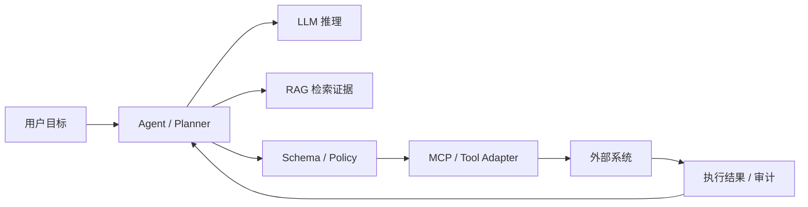

# RAG / MCP / Agent 三层职责

> 来源：按可检索历史会话线索整理，部分表达为知识性归纳，非逐字原话。

**RAG** 是检索证据进入模型上下文的机制，**MCP** 是标准化连接外部资源/工具的协议，**Agent** 则在目标约束下组织推理、工具调用、状态更新与验证。不能把三者当作互斥替代。

一个反复出现的工程准则是：**LLM 负责推理，Schema 负责约束，Policy 负责授权，Domain Logic 负责正确性，Database 负责一致性**。对外部输入和工具返回始终防范 Prompt Injection，关键写操作保留 human-in-the-loop。
