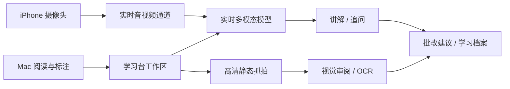

# Mac × iPhone 多模态学习台需求

> 来源：按可检索历史会话线索整理，部分表达为知识性归纳，非逐字原话。

核心目标（2026-10-24）：Mac 大屏阅读，iPhone 支架作为实时摄像头，AI 能保持持续视频/语音沟通，讲解书本并审阅作业、试卷。

核心工程拆分：实时会话强调延迟和持续互动；高清作业批改强调细节、证据定位和可复查。两者可以共享学习档案，但不应为追求“全由单一模型承担”而牺牲输入质量。
