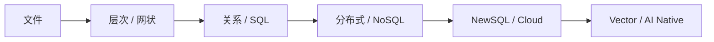

# 从存储到智能的进化链

> 来源：按可检索历史会话线索整理，部分表达为知识性归纳，非逐字原话。

讨论过的数据库进化主线：文件系统 → 层次/网状模型 → 关系模型与 SQL → 事务与 OLTP → NoSQL / 分布式 → NewSQL → 云、HTAP、Lakehouse → 向量数据库与 AI-Native 应用。

这是需求驱动的历史脉络，而不是每种系统已被下一种取代；现实中关系数据库、KV、列存、图与向量检索会长期共存。
