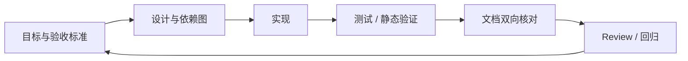

# 工程治理闭环与 Spec 漂移

> 来源：按可检索历史会话线索整理，部分表达为知识性归纳，非逐字原话。

既有讨论集中在项目健康体检、BUG 修复、文档与代码双向认证、测试完善、AGENTS.md 分类网关、Spec 漂移等。

一个完整闭环应保留每项约束如何对应到代码、测试、文档与发布记录。AGENTS.md 适合约定 Agent 工作习惯与边界，但不能替代可靠的构建/测试和人类审批。
