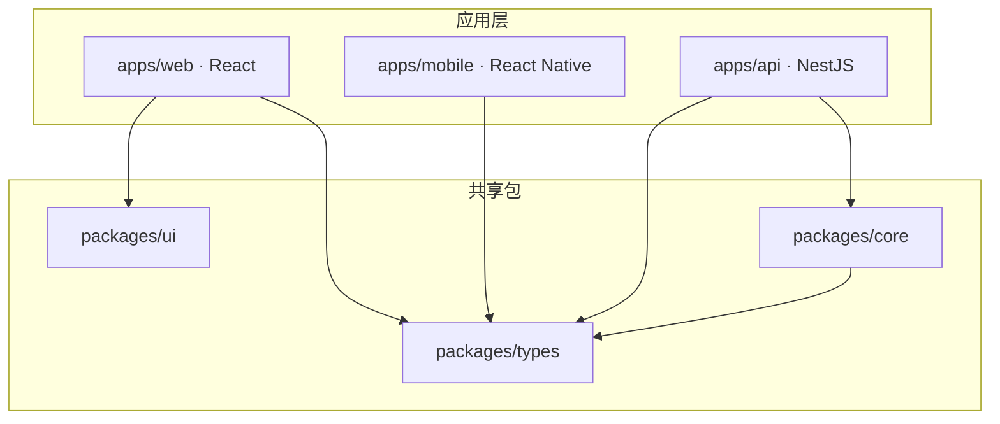

# React / React Native / NestJS 项目结构

> 来源：按可检索历史会话线索整理，部分表达为知识性归纳，非逐字原话。

场景为 `React + React Native + NestJS + pnpm`。根问题不是“选哪一个工具”，而是**依赖关系不明确**。

依赖应显式声明，包边界要有 lint/CI 校验。TypeScript `references` 可加速多项目构建，但不能替代 workspace 的发布版本治理。建议先绘出真实依赖图再添加任务缓存，避免缓存掩盖错误依赖。
