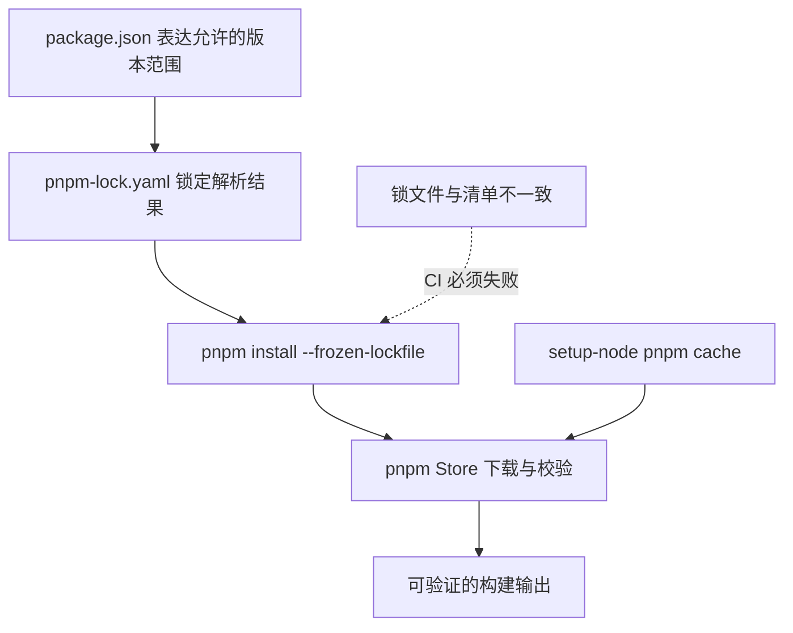

# 05 · 为什么必须提交 pnpm-lock.yaml（以及如何缓存）

## 本章目标

同一份 `package.json` **不意味着**重装会得到完全相同的依赖图。`^`、`~` 和间接依赖的范围匹配可能在不同日期解析到不同包。将所有直接/间接依赖的具体解析结果与完整性校验放入 `pnpm-lock.yaml`，才能对可复现安装做出有意义的承诺。

本专题的实际项目放在 `knowledge/monorepo/fullstack/project/`，锁文件位于其工作区根目录，而不是 GitHub 仓库根目录。所有 CI 任务必须在该目录执行 `pnpm install --frozen-lockfile`。

## 正确的三层模型



1. **一致性**：依赖清单变化而锁文件未更新，`--frozen-lockfile` 应失败，不应悄悄重新解析。
2. **缓存**：GitHub `setup-node` 的 `cache: pnpm` 缓存下载仓库，不是 `node_modules`。`cache-dependency-path` 指向内层工作区锁文件。
3. **完整性**：pnpm 校验远程包完整性信息。锁住版本仍不等于审计、SBOM、漏洞扫描和软件供应链全流程治理。

## 本地复现实验

```bash
cd knowledge/monorepo/fullstack/project
corepack enable
pnpm install --frozen-lockfile
pnpm build && pnpm typecheck && pnpm test
# 演示拒绝漂移：临时修改一个依赖版本后再执行
pnpm install --frozen-lockfile  # 应拒绝不同步的 manifest
# 撤销 package.json 修改，千万不要把演示修改提交
```

## pnpm 12 的双文档锁文件（重要）

pnpm 12 可能把 `pnpm-lock.yaml` 写成 **两份 YAML 文档**：第一份保存 pnpm 本身及配置依赖，第二份才是业务工作区依赖图。不能用只接受单文档的 YAML 解析器读取第一份后就宣称「没有依赖」。进行 SBOM / 依赖关系分析时，要读取最后一份项目依赖图；进行全量供应链扫描时需考虑两份文档。项目 `tools/verify-lockfile.mjs` 特意验证最后一份项目文档。详见 [pnpm 官方 Lockfile 文档](https://pnpm.io/lockfile)。

## 缓存为何不应替代锁文件

缓存中即使存在包，也不能证明这次构建使用的依赖正确；缓存 key 应包含锁文件内容哈希。不要直接缓存整个 `node_modules`（可能包含平台二进制和不可移植符号链接）。在不同 OS 的 Android/macOS 工作流里允许不同缓存，避免交叉污染。

## 维护建议

升级依赖时，在开发分支进行 `pnpm update`，核对锁文件 diff，确保最小变更、完成测试再合并。每次 pnpm 版本升级要视为基础设施变更，并在 CI 中锁定包管理器版本。生产发布还应使用依赖审计、签名和供应链权限隔离。

**参考**：[pnpm install](https://pnpm.io/cli/install) · [GitHub actions/setup-node](https://github.com/actions/setup-node/blob/main/docs/advanced-usage.md)
