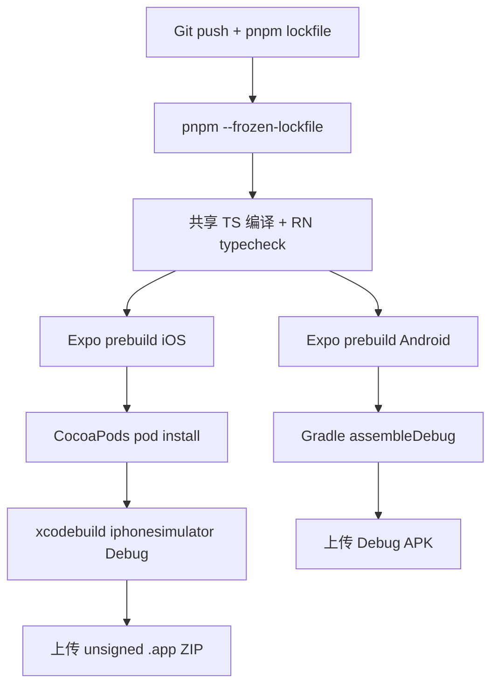

# 06 · 从 RN 类型检查到 Android / iOS 真正编译

## 不同验收的证据等级

| 级别 | 能证明什么 | 不能证明什么 |
|---|---|---|
| `tsc --noEmit` | TypeScript 接口与类型检查 | Metro bundle / 原生 Gradle / CocoaPods |
| `expo prebuild` | Expo 配置能够生成原生目录 | C++/Kotlin/Swift/ObjC 能编译 |
| `gradlew :app:assembleDebug` | Android 原生调试 APK 编译 | 真机安装、网络、商店签名 |
| `pod install + xcodebuild` | iOS 模拟器 App 编译（若 CI 通过） | iPhone 真机签名、App Store 发布 |
| 模拟器 / 真机回归 | 设备实际渲染与行为 | 所有性能、安全和网络状态 |

## 工具链版本

- Expo SDK 58 → React Native 0.88, React 19.3；Node 22.13+。
- Android SDK：`compileSdkVersion 37`，`targetSdkVersion 36`，JDK 17。SDK Manager 的实际平台包名是 `platforms;android-37.0`，使用 `--channel=3` 显式安装。
- iOS：Xcode 26.4 及更新版本。CI 使用 macOS 26 + Xcode 26.4.1，`CODE_SIGNING_ALLOWED=NO`，仅针对模拟器。
- 主工程根目录：`knowledge/monorepo/fullstack/project`，不是仓库根目录。

## 自动化流水线



## 构建与签名分离

Android Debug APK 通常会用 Android SDK 自动生成的开发调试密钥签名，但**不能**把这种调试签名等同于正式商店发布签名。Android 发布版需要独立签名密钥；iOS 真机/分发需要 Apple Developer Team、Provisioning Profile、Certificates（或 EAS Build 提供签名服务）。**绝对不要把密钥或证书提交到 GitHub**。本专题只演示无敏感密钥的基础构建。

## 调试手册

- **预构建失败**：检查 app.json 中 Android 包名和 iOS bundleIdentifier、原生模块版本、Expo config plugins。
- **Gradle 失败**：确认 Android API 37、JDK 17、NDK、磁盘空间；比较 `expo prebuild` 的生成输出。注意 pnpm 默认孤立布局不是所有原生库都兼容，必要时才切换 hoisted，并在锁文件中重新验证。
- **CocoaPods 失败**：确认 `pod` 命令、Ruby 环境和 Xcode 26.4+；核对 CocoaPods 错误与 Expo autolinking。
- **Xcode 构建失败**：先确保 simulator 与设备目标一致、禁止签名、当前 scheme 存在；从日志中区分 Swift/ObjC/C++ 源码错误与平台环境故障。

CI 的实际成功与失败必须以 GitHub Actions 为准；仅提交工作流不代表编译已经成功。

**参考**：[Expo local builds](https://docs.expo.dev/guides/local-app-development/) · [Expo SDK 58](https://docs.expo.dev/versions/v58.0.0/) · [Expo Monorepos](https://docs.expo.dev/guides/monorepos/)

## 实际构建记录：Android 37.0 SDK 安装

首次 CI 在 Gradle 编译之前失败，日志为：`Warning: Failed to find package 'platforms;android-37'`。

**问题根因**：`compileSdkVersion 37` 是 Gradle/Expo 的编译级别，而 SDK Manager 仓库的安装坐标是 `platforms;android-37.0`。修复 SDK 安装步骤：

```sh
sdkmanager --channel=3 'platforms;android-37.0' 'build-tools;37.0.0'
test -f "$ANDROID_HOME/platforms/android-37.0/android.jar"
```

此调整只能证明尝试安装正确的 SDK，**不等同于 Gradle 编译或 Android APK 已通过**。需要以 GitHub Actions 的原生任务日志为准。
