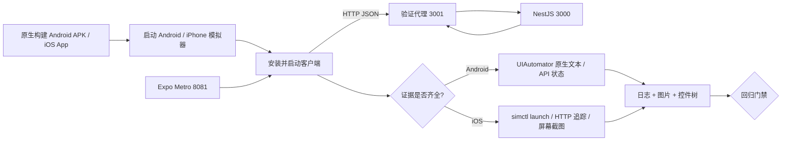

# 08 · 从编译通过到真实模拟器验证：设备烟雾测试

> 更新：2026-10-31 · 本章内容从 CI 实践出发。**编译成功 ≠ 启动成功 ≠ UI 可用 ≠ 真机发布就绪**。

## 为什么必须分四种不同的证据

1. **构建证据**：Android Gradle `assembleDebug` 产生 APK；Xcode `iphonesimulator` 编译产生无签名 `.app`。这一层已在前一轮 GitHub Actions 成功验证。
2. **启动证据**：模拟器完成开机，安装 APK/.app，通过 Android ActivityManager / iOS `simctl launch` 真正创建进程。仅凭进程号不足以判断 JS 是否加载完成。
3. **运行与数据证据**：Expo Metro 提供 JS bundle；NestJS API 运行；客户端通过 HTTP 请求并收到可验证的 `revision=1`、三条课程 JSON。Android 进一步从 UIAutomator 的真实控件树检查欢迎文本、API 连接状态。
4. **真机证据**：用实际 Android 设备和 iPhone 检查权限、蜂窝网络、弱网、后台生命周期、摄像头与麦克风、电池与内存。目前自动化的 GitHub Runner 不具备此层证据。

## 测试架构



**说明**：图中的“验证代理”是仅用于设备测试的透明 HTTP 转发器，它不是产品后端，也不会进入生产 APK。它观察到客户端真实请求并检查 NestJS 返回的 JSON。Android 与 iOS 的调试版 App 都必须连接 Metro，不能把纯原生 Activity 启动误判成业务功能成功。

## Android：API 35 模拟器运行 SDK 37 编译的 App

- 构建阶段使用 Expo 58 规定的 Android SDK `platforms;android-37.0`，**编译 SDK** 为 37。
- **运行模拟器**使用稳定可用的 Android API 35 x86_64 系统镜像。编译 SDK 与模拟器 OS 版本不同是正常的，但不能由此推断 Android 37 系统已验证。
- GitHub Actions 启用 KVM 后使用 `reactivecircus/android-emulator-runner@v2`。<https://github.com/ReactiveCircus/android-emulator-runner>
- 测试 APK 为 **debug 构建**；运行前必须启动 Metro。使用 `adb reverse tcp:8081 tcp:8081` 访问 JS bundle，并用 `adb reverse tcp:3001 tcp:3001` 访问本地 HTTP 验证代理。
- `adb shell am start` 后要求代理收到来自客户端的有效 JSON 请求，UIAutomator 原生 UI 树中必须同时出现 `KNOWVERSE / NATIVE RUNTIME` 和 `NestJS API 连通`。然后通过 UIAutomator 找到可访问的 `重新验证 API` 按钮，使用 ADB 真正触发一次点击；要求 HTTP 代理记录第二次课程请求。这样不仅检查首帧，还覆盖了一条真实用户交互。
- 保存 `android-ui.xml`、`android-final.png` 和 `android-logcat.txt`。若失败则将这些产物上传供审查。

## iOS：无签名模拟器 App

- Xcode 的 `iphonesimulator` 构建不需要苹果开发者证书；它**不能**直接安装到真实 iPhone。
- CI 选择 Runner 已安装的 iPhone Simulator，执行 `simctl boot → install → launch`，启动 Metro 和同一个 NestJS 验证代理，等待一条来自客户端的有效 JSON 请求，然后保存模拟器截图。
- 不使用屏幕 OCR 冒充 UI 自动化断言：本轮 iOS 的证据是**实际启动 + 实际客户端 HTTP + 截图**，不是 XCTest 控件树测试。
- 保存 `ios-final.png`、`ios-launch.txt`、`ios-device.log`、API/Metro 启动日志。

## 本地复现（需对应 SDK 和平台）

```bash
cd knowledge/monorepo/fullstack/project
pnpm install --frozen-lockfile
pnpm build:shared
pnpm --filter @kv/api build
pnpm --filter @kv/mobile typecheck
# 根据当前设备，先完成 expo prebuild + Gradle 或 CocoaPods / Xcode 构建。
# 再运行下面一个脚本（必须有模拟器设备）：
bash tools/device-smoke/android.sh
# 或在 macOS 且已构建 Simulator App 的前提下：
bash tools/device-smoke/ios.sh
```

## 不能越界的结论

- Android UIAutomator 检查通过说明该测试窗口内欢迎界面和 API 状态可见，不代表性能、可访问性或所有导航都正确。
- iOS 模拟器启动和 HTTP 请求通过，仍然需要人工或 XCTest 进一步验证 UI 内容与 VoiceOver。
- Android API 35 模拟器结果不代表 Android API 37、所有硬件机型、Release 签名、Google Play 发布。
- iOS Simulator 运行不等于签名真机应用，也不能替代蓝牙、麦克风、相机、蜂窝、后台保活测试。
- CI 截图、网络请求与日志同时保留，不能将 `if: always()` 上传的故障产物当作测试通过。

参考：[Expo 使用开发构建](https://docs.expo.dev/develop/development-builds/introduction/) · [Android Emulator Runner](https://github.com/ReactiveCircus/android-emulator-runner) · [Apple simctl 文档](https://developer.apple.com/documentation/xcode/running-your-app-in-simulator-or-on-a-device)

## 本专题保存的真实设备证据

- [Android 模拟器截图](../evidence/android-emulator.png) · [对应构建与测试日志](https://github.com/liucaidong/knowverse/actions/runs/41116367227)。
- [iPhone Simulator 截图](../evidence/ios-simulator.png) · [对应构建与测试日志](https://github.com/liucaidong/knowverse/actions/runs/41116367539)。

均为 **Debug 环境下的真实截图**，调试警告提示不会在这里被修饰掉。图片证明测试时的 UI 呈现，不代表真机发布质量。
