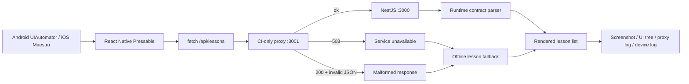

# 第九章｜跨端 E2E：把网络故障变成可重复的工程实验

> 本章记录 Android Emulator 与 iPhone Simulator 的端到端验收方法。**Node 单测通过不等于设备测试通过；模拟器通过也不等于真机发布就绪。** 每次设备结论必须关联同一 Git commit SHA、工作流记录和失败/成功证据。

## 1. 四层独立证据

1. **构建**：Gradle 产出 APK；Xcode 产出 Simulator `.app`。
2. **启动与渲染**：真实模拟器安装应用、加载 Metro JavaScript Bundle，课程 UI 出现在无障碍树中。
3. **交互与网络**：Android UIAutomator / iOS Maestro 真正点击 React Native `Pressable`，客户端请求经由测试代理转发到 NestJS。
4. **恢复与回归**：注入 HTTP 503、非法 JSON，确认客户端回退到本地课程；恢复代理后再次请求，重新获得合法课程数据。

## 2. 测试拓扑与信任边界



`api-proxy.mjs` 仅在 CI 使用，绑定 `127.0.0.1`；控制端点要求 `KV_DEVICE_TEST_MODE=1` 且请求来自 loopback。它不会进入生产后端，也不可暴露到公网。测试代理会预先创建事件日志，即使第一个响应就不合法也不会出现“文件不存在”的假故障。

## 3. 受控故障矩阵

| 场景 | 控制值 | 客户端结果 | 代理证据 |
|---|---|---|---|
| 正常请求 | `ok` | 显示课程与契约验证成功 | `valid-api-hit` |
| 服务不可用 | `http-503` | 显示 API 不可用，保留离线课程 | `injected-http-503` |
| HTTP 成功但响应非法 | `malformed-json` | JSON 解析失败，保留离线课程 | `injected-malformed-json` |
| 恢复 | `ok` | 再次拉到三节合法课程 | 新的 `valid-api-hit` |

“HTTP 200”不等于业务契约成功。NestJS 上游回包必须满足 revision、课程数量、字段类型、level 枚举和正数时长约束，才能记作 `valid-api-hit`；非法 JSON 与非法 schema 分别记录，绝不会计入成功次数。

## 4. 防止 UI 旧状态造成假阳性

第一次故障注入测试暴露了一个重要的自动化缺陷：iOS Maestro 在 503 之后再次点击，测试只断言“API 不可用”可见；旧的 503 文案满足了断言，但这次点击并没有发出新请求。

当前流程修正为：

1. 通过 `testID=kv-api-refresh` 定位真实按钮；
2. 点击后先等待唯一的服务器事件计数增长，证明新请求确实离开客户端；
3. 再等待与本次场景匹配的终态：HTTP 503、SyntaxError 或成功状态；
4. 不把短暂 loading 文案当作必过条件，避免 UI 自动化采样间隔造成误报；
5. 连续故障场景使用不同错误签名，防止上一次错误文案满足本次断言。

CI 代理对响应增加 4.5 秒、仅 `KV_DEVICE_TEST_MODE=1` 生效的观察延迟，让模拟器有时间采集请求、状态与证据；loading 只作为诊断信息，不是端到端通过条件。正常代理不会增加人为等待，也不会出现在生产环境。

## 5. 平台执行器

### Android

- 使用 `adb reverse` 连接 Metro 与代理；UIAutomator 读取真实控件树。
- 从节点的 `bounds` 计算“重新验证 API”中心位置，再由 `adb shell input tap` 点击；不使用臆造坐标。
- 每个故障场景之后必须等待代理事件，检查离线回退和恢复。
- 保存 `android-initial.png`、`android-unavailable.png`、`android-recovered.png`、UI XML、Logcat、代理日志。

### iOS

- 使用固定版本 Maestro 2.11.0，通过 iOS 无障碍树执行 `tapOn`。
- 每个 Flow 先验证按钮可见，再真实点击，最后断言本场景独有的终态；脚本还会等待独立代理事件计数，避免旧 UI 状态造成假阳性。
- `run-maestro.py` 对每个流程设置最大运行时间并将输出写入独立日志，失败时仍上传截图和系统日志。
- 保存初始、不可用、恢复截图，以及 `maestro-*.log`、`ios-device.log` 和 API/代理日志。

## 6. 本地复现

```bash
cd knowledge/monorepo/fullstack/project
pnpm install --frozen-lockfile
pnpm build:shared
pnpm --filter @kv/api build
pnpm --filter @kv/mobile typecheck
node --test tests/device-proxy.test.mjs tests/device-faults.test.mjs
# 在完成 Expo prebuild 与原生编译、并启动模拟器的 CI / 开发机中：
bash tools/device-smoke/android.sh
bash tools/device-smoke/ios.sh
```

## 7. 通过标准与边界

- 两端初始请求成功，UI 显示课程列表。
- 点击刷新后，代理出现第二次合法请求。
- 503 和非法 JSON 必须分别由**真实客户端请求**触发，并产生独立事件。
- 恢复 `ok` 后客户端重新拉到合法课程，代理记录后续有效命中。
- 所有步骤成功才算 E2E 成功；`if: always()` 仅保证上传证据，不能把失败工作流改写成通过。
- 模拟器 API 35 / iPhone Simulator 不代表所有 Android/iOS 版本与物理设备；真实手机仍需验证 Wi-Fi/蜂窝、权限、后台生命周期、摄像头/麦克风和 Release 签名。

## 官方参考

- [Maestro iOS 支持](https://docs.maestro.dev/get-started/supported-platform/ios)
- [Maestro CLI 安装](https://docs.maestro.dev/maestro-cli/how-to-install-maestro-cli)
- [Android Emulator Runner](https://github.com/ReactiveCircus/android-emulator-runner)
- [Expo 本地原生开发](https://docs.expo.dev/guides/local-app-development/)

## 8. 迭代中发现的自动化误报

首轮回归暴露两种误报：Android UIAutomator 轮询没有采样到 4.5 秒的短暂 loading 状态；iOS Maestro 则以不带省略号的字符串匹配 loading，实际控件文本的标点导致断言失败。

修复原则：不把短暂中间态当作唯一成功标准。每个场景均使用独立代理事件与专属最终错误签名：503 断言 HTTP 503，非法 JSON 断言 SyntaxError，恢复断言成功状态和新的 valid-api-hit。这样既不会放过未发请求，也不会被旧错误文案骗过。

## 9. 本轮真实模拟器回归记录（2026-10-31）

本轮在同一个临时验证分支、同一测试源版本下完成，正式版本将该测试方法与工程源码一次性合并。

| 平台 | 设备环境 | 自动化 | 结果 |
|---|---|---|---|
| Android | Android Emulator API 35 / x86_64 | ADB + UIAutomator | 四场景通过 |
| iOS | iPhone 17 Pro Simulator / iOS 26.4 | Maestro 2.11.0 | 四场景通过 |
| 内容与项目 | Ubuntu GitHub Runner | 575 处 Monorepo 链接检查、ZIP 与源码一致性、代理单元测试 | 通过 |

**Android 运行记录：** [GitHub Actions #41161864154](https://github.com/liucaidong/knowverse/actions/runs/41161864154)

日志逐项证明：初次请求 valid-api-hit=1；刷新后 =2；503 注入后界面显示 HTTP 503；非法 JSON 注入后界面显示 SyntaxError；恢复后 valid-api-hit=3，界面重新显示三节课程。

**iOS 运行记录：** [GitHub Actions #41161864164](https://github.com/liucaidong/knowverse/actions/runs/41161864164)

Maestro 2.11.0 四个独立 Flow（refresh / unavailable / malformed / recovered）均执行 tapOn 并完成对应 UI 终态断言；代理记录首次、刷新、恢复三次合法命中以及两种故障注入事件。

**内容校验记录：** [GitHub Actions #41162027680](https://github.com/liucaidong/knowverse/actions/runs/41162027680)

该轮验证会生成并上传两个设备证据包：knowverse-android-device-evidence-11、knowverse-ios-device-evidence-11。GitHub Actions 工件有保留期限；正式仓库保留测试脚本、验收步骤和可重复执行方式，物理设备仍需单独验收。
