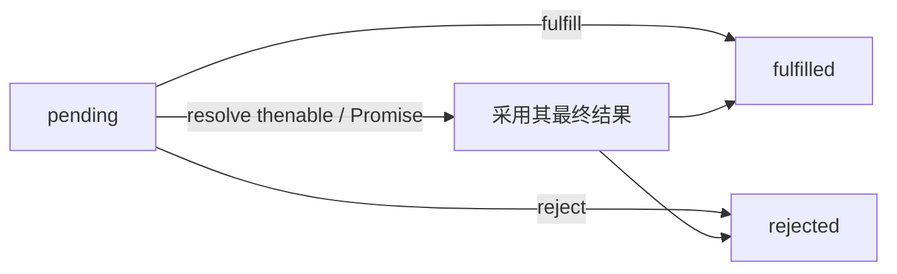

# 核心机制与状态机

> 来源：按可检索历史会话线索整理，部分表达为知识性归纳，非逐字原话。

Promise 的三个状态是 `pending`、`fulfilled`、`rejected`。一旦落定不可逆，但调用 `resolve(x)` 不等同于立即进入 fulfilled：当 `x` 是 thenable 或另一个 Promise 时，当前 Promise 可能进入已解决但尚未落定的跟随过程。这个差别是课程第 14 课最重要的诊断点之一。



Executor 在构造 `new Promise(executor)` 时同步调用；`.then` 处理器并不会同步执行。即使来源已落定，反应也要通过 Promise jobs 调度。不要把“状态已变化”“reaction 已入队”“处理器开始执行”合并为同一瞬间。

```js
const inner = Promise.resolve(42);
const a = Promise.resolve(inner);
const b = new Promise(resolve => resolve(inner));
console.log(a === inner, b === inner); // true false
```

**学习诊断**：先写出每个对象何时创建、何时绑定 reaction、何时入队，再做输出顺序预测；不要单凭最终打印结果倒推同步关系。
