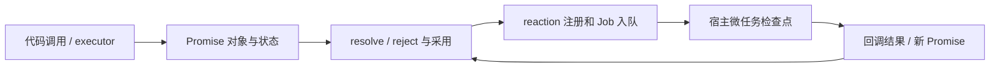

# 导学：这门课不是背 API

> **学习目标**：看到一段异步 JavaScript，能够独立画出 Promise 对象、状态变化、反应注册、Job 队列和实际输出的先后顺序。这里依据此前课程第 1—14 课的可恢复线索重构知识体系，不代表每道历史习题均已完成。

## 一张概念地图

Promise 是**未来结果的占位符**，不是任务调度器，也不是线程。理解一段代码，需要分别回答五个问题：**创建了哪些 Promise 对象？谁取得了解决权？何时落定？何时把 reaction Job 入队？Job 何时运行？**



## 学习顺序与课程阶段

| 单元 | 要解决的错误直觉 | 学会之后能解释什么 |
|---|---|---|
| 01–03 | `resolve` 就是立刻 `fulfilled` | resolved、settled、thenable 采用 |
| 04–06 | `.then` 回调立即执行 | executor 同步、Job 入队、链式新对象 |
| 07–10 | `catch/finally` 只是语法糖 | 错误恢复、finally 覆盖、async/await |
| 11–14 | 四个组合 API 只有返回值差异 | 胜出规则、空输入、索引顺序、失败分支 |
| 15–17 | 微任务只有“先来先服务”一条公式 | Browser / Node 宿主差异、thenable Job 和复盘 |

## 本专题的用法

每章按 **可观察现象 → 原因 → 代码试验 → 常见误区 → 诊断任务** 排列。先用纸笔预测，再在“可运行实验”运行代码；正确选项不等于掌握，必须说明原因。专题首页的“执行观察台”会显示日志和逐帧轨迹；本章参考资料可在专题末尾集中查看。

## 一道预热题

```js
console.log('start');
new Promise(resolve => {
  console.log('executor');
  resolve(1);
}).then(() => console.log('then'));
console.log('end');
```

**先预测输出**。本题检查的是 executor 的同步性与 reaction 的异步性，答案请在章节最后的自测区揭晓。

<details><summary>展开预热题答案</summary>

`start → executor → end → then`。创建 Promise 时 executor 同步执行；`.then()` 注册反应，即使对象已经 fulfilled，回调也在后续 Job 中执行。

</details>
