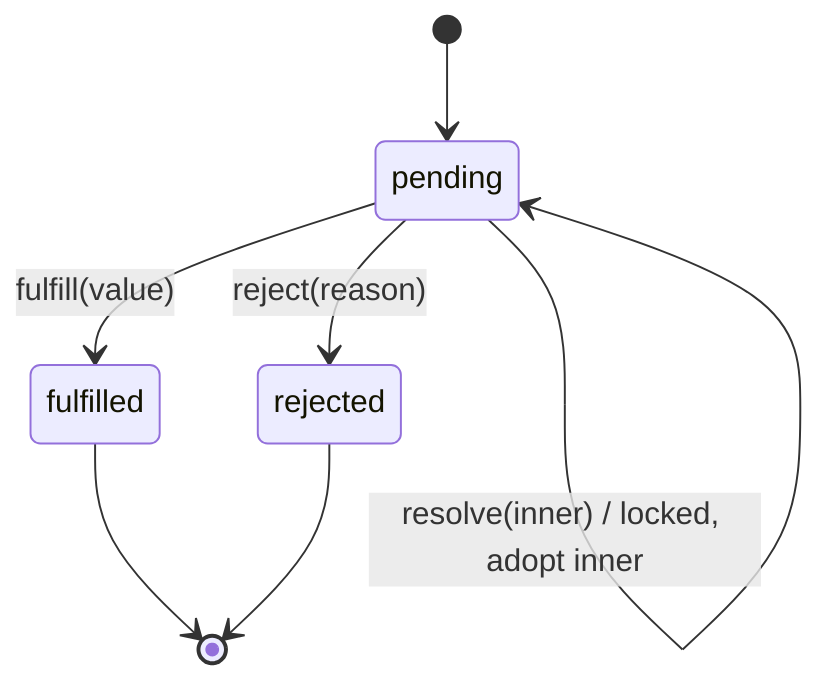

# Promise 状态机与“已经解决”

## 三种状态；两个容易混淆的术语

一个 Promise 始终处于 `pending`、`fulfilled`、`rejected` 三者之一。`settled` 指 **fulfilled 或 rejected**；`resolved` 则是 **解决权已锁定**：它可能已经落定，也可能正在采用其他 Promise 的结果、自己仍处于 pending。



注意：图中 `pending → pending` 并非发生了状态切换，而是**外观状态仍 pending、内部解决权已锁定**。它和 `new Promise(() => {})` 这种未解决 pending 不同。

## 以 inner 为例观察两个 Promise

```js
let finish;
const inner = new Promise(resolve => { finish = resolve; });
const outer = new Promise(resolve => resolve(inner));
// outer 已 resolved，但 inner 未落定，因此 outer 仍 pending
outer.then(v => console.log('outer', v));
finish(42);
console.log('synchronous end');
```

调用 `resolve(inner)` 后，后续 `reject('late')`、`resolve(0)` 或 executor 抛错都不能改变 outer 已经采用 inner 的决定；**不能**因此说 outer 同步 fulfilled。`finish(42)` 使 inner 先获得兑现结果，outer 的状态传播仍需要通过 Promise 机制完成。

## 同一性与“采用”是两个维度

```js
const inner = Promise.resolve(42);
const a = Promise.resolve(inner);
const b = new Promise(resolve => resolve(inner));
console.log(a === inner, b === inner); // true false
```

当 `Promise.resolve(x)` 收到相同构造器的原生 Promise，可能**直接返回原对象**；`new Promise(...)` 总创建新对象，即使它采用了 inner 的最终值。身份相同与状态传播的先后并不是同一个问题。

## 常见误区

- “resolved = fulfilled”——错；`resolved` 指命运已经被锁定。
- “状态不能反转，所以任何 `resolve` 都立刻完成”——错；采用未落定的 thenable 可以继续 pending。
- “两个 Promise 最终都是 42，所以 `===` 一定相等”——错；值相等不代表对象同一。

**检查点**：尝试在 `resolve(inner)` 后立即调用一次 `reject(new Error('late'))`；然后让 inner 兑现或拒绝。预测 outer 会如何落定。
