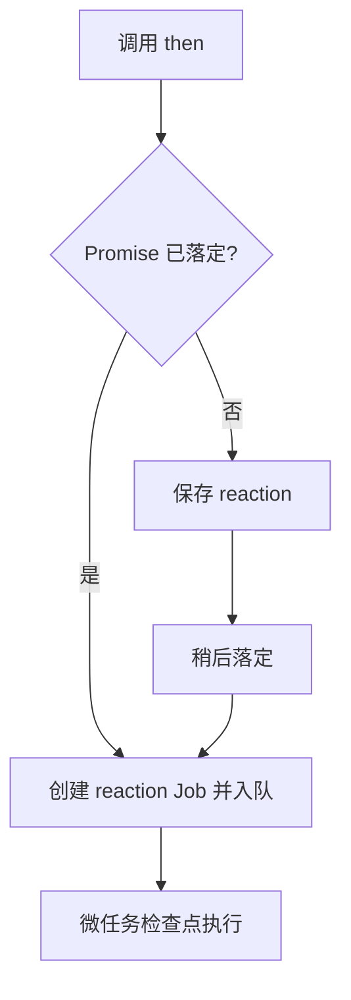

# `new Promise()` 不是异步启动器

## executor 当场执行

```js
console.log('1');
const p = new Promise(resolve => {
  console.log('2');
  resolve('ok');
});
p.then(() => console.log('4'));
console.log('3');
// 1 2 3 4
```

`new Promise(executor)` 在构造过程**同步调用 executor**。真正的异步边界是注册之后由 Promise reaction Job 运行的处理器。因此把“创建 Promise”当作“延迟执行一个函数”是错误模型。

## 反应有两种入队时刻

当 `.then(handler)` 调用时：

1. **对象仍 pending**：先保存 reactions；以后落定时，逐个将相应 reaction jobs 加入队列。
2. **对象已经 settled**：这次 `.then` 的反应 job 在调用 `.then` 时就被入队；处理器依然不会同步运行。



## “注册先后”和“执行先后”

```js
const p = Promise.resolve('done');
p.then(() => console.log('A'));
queueMicrotask(() => console.log('M'));
p.then(() => console.log('B'));
// A M B
```

这是浏览器和标准 JavaScript Promise Job 的常见情况。关键不是“`.then` 永远比 `queueMicrotask` 优先”，而是**这三个 job 按 A、M、B 的顺序实际入队**。

## 诊断

如果把 `Promise.resolve('done')` 换成一个尚未落定的 `p`，再把 `resolve()` 放在 M 的回调中，`A` 和 `B` 将延后入队：此时要重新画队列，不能照抄 `A M B`。
