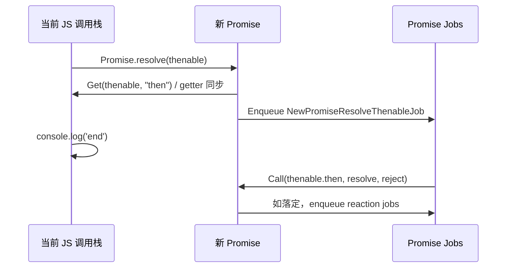

# thenable 同化：本课程的核心边界

## thenable 与原生 Promise 不同

对象只要暴露可调用的 `.then`，就可能被 Promise 解决流程**当作 thenable**。采用 thenable 时，先取得 `then` 属性；如为可调用函数，则安排一个 **NewPromiseResolveThenableJob** 在稍后的 Job 中调用它。

```js
const thenable = {
  get then() {
    console.log('get');
    return resolve => {
      console.log('call');
      resolve(42);
    };
  }
};
console.log('start');
Promise.resolve(thenable).then(v => console.log('value', v));
console.log('end');
// start, get, end, call, value
```

`get` 是**同步属性读取**；`call` 则是后续 PromiseResolveThenableJob 执行。**getter 和 thenable 本身不是两个并列的任务**，混为一谈会直接导致日志顺序预测错误。



## 解决权锁定、晚到的 reject/throw

```js
let finish;
const inner = new Promise(resolve => { finish = resolve; });
const obj = { then(resolve, reject) {
  resolve(inner);             // 先占有解决权，采用 inner
  reject(new Error('late')); // 被忽略
  throw new Error('boom');   // 不能覆盖已锁定的解决结果
}};
const outer = Promise.resolve(obj);
outer.then(console.log, console.error);
finish(42);
```

这并不是 `throw` 从未发生，而是 thenable Job 捕获异常、发现解决回调已调用后**不会再改变已锁定的 outer**。需分清“执行了什么”和“最后能影响谁”。

## 异常路径与自解析

- 读取 `then` 属性时 getter 抛错：新 Promise **拒绝**，不会再调用 then。
- `then` 不是函数：把该对象作为普通值兑现。
- `resolve(promise自身)`：发生自解析，触发 `TypeError` 拒绝。
- 别的 thenable 循环、互相引用的情况更复杂，**不能**将每一种循环都说成即时 TypeError；规范中直接检测的是 promise 对自身解析。

```js
let resolveSelf;
const p = new Promise(resolve => { resolveSelf = resolve; });
resolveSelf(p);
p.catch(e => console.log(e instanceof TypeError)); // true
```

## 检查点

把上面 getter 改成 `throw new Error('get-failed')`，预测 `call` 是否会出现、outer 最终是什么状态。答案：`call` 不会出现，outer 拒绝，catch 在 reaction Job 中执行。
