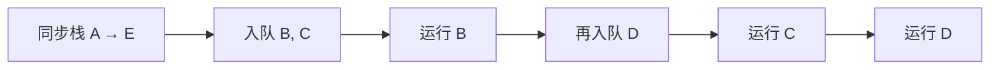

# 事件循环不是“微任务优先”四个字

## 五步可重复的推演法

**阶段 A：同步调用栈**。逐行标注 console、executor、thenable getter 和 `.then` 注册。**阶段 B：每一个入队动作**。写出 `PromiseReactionJob`、`PromiseResolveThenableJob` 和显式 `queueMicrotask`。**阶段 C：每次取出队首**。执行可能又入队新的任务。**阶段 D：记录每个 Promise 的状态**。**阶段 E：进入后续 timer 等任务**。

```js
console.log('A');
Promise.resolve().then(() => {
  console.log('B');
  queueMicrotask(() => console.log('D'));
});
queueMicrotask(() => console.log('C'));
console.log('E');
// A E B C D
```

| 时刻 | 当前动作 | 微任务队列 | 输出 |
|---|---|---|---|
| 同步 | `console.log('A')` | [] | A |
| 同步 | `.then(...)` | [B] | — |
| 同步 | `queueMicrotask(C)` | [B, C] | — |
| 同步 | `console.log('E')` | [B, C] | E |
| 检查点 | 执行 B、再入队 D | [C, D] | B |
| 检查点 | 执行 C | [D] | C |
| 检查点 | 执行 D | [] | D |



## 为什么 `then` 链不是一次 job

```js
Promise.resolve().then(() => {
  console.log('one');
  return 2;
}).then(() => console.log('two'));
queueMicrotask(() => console.log('M'));
// one M two
```

第一个 `.then` 的回调完成后，**下游 Promise 才兑现、第二个 reaction 才被入队**。M 已经在队列里，所以它先于 `two`。

## 环境边界

浏览器事件循环的 task/microtask 规则由宿主定义；ECMAScript 定义 Promise Jobs，但不独立规定浏览器渲染时机或 Node 特有的 nextTick 队列。不要用“宏任务先后”替代具体 API 的宿主定义。
