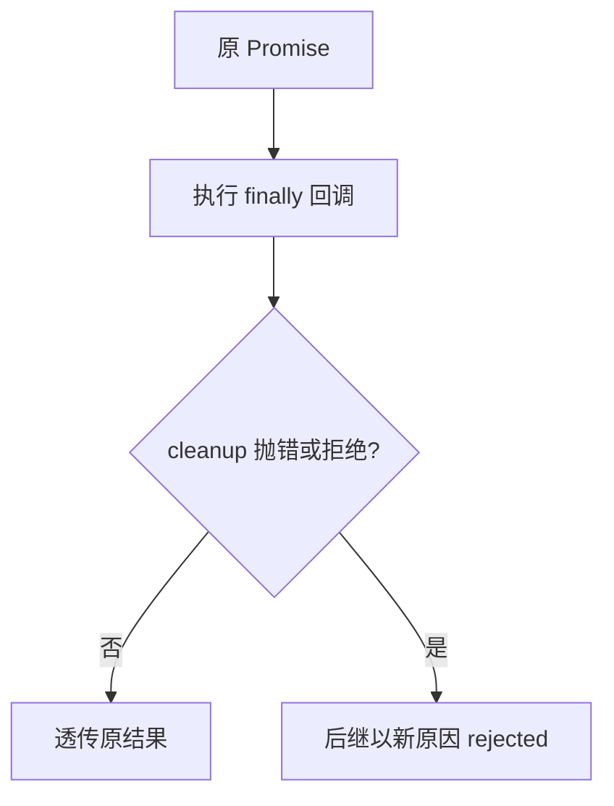

# `catch` 处理失败，`finally` 处理收尾

## catch 恢复与传播

`p.catch(onRejected)` 对拒绝作出响应。如果 `onRejected` 正常返回，后继 Promise 变为 fulfilled；如果再次抛错或返回拒绝的 Promise，拒绝继续传播。

## finally 是透传，不是无条件保真

```js
Promise.resolve(7)
  .finally(() => console.log('cleanup'))
  .then(v => console.log('value', v));
// cleanup
// value 7
```

```js
Promise.resolve(7)
  .finally(() => Promise.reject(new Error('cleanup failed')))
  .then(console.log)
  .catch(e => console.log(e.message));
// cleanup failed
```

在 cleanup 正常结束时，`finally` **透传原有 fulfilled 值或 rejected 原因**；若 cleanup 抛错或返回的 thenable 最终拒绝，会用新的拒绝覆盖原结果。`finally` 回调的普通返回值（比如 `return 100`）不会改写成功结果。



## 定时器里的 `throw` 为什么捕不住

```js
new Promise(resolve => {
  setTimeout(() => { throw new Error('timer'); }, 0);
  resolve(1);
}).catch(e => console.log('will not catch', e));
```

定时器回调在**未来单独的任务执行上下文**中运行，已脱离 executor 同步调用的 `try/catch`。正确的桥接方式是在回调里**调用 reject**，而不是在外层等待一个与定时器毫无关联的 Promise。

```js
const wait = ms => new Promise((resolve, reject) => {
  setTimeout(() => {
    try { resolve('done'); }
    catch (error) { reject(error); }
  }, ms);
});
```

上面只是演示如何把异步回调的失败交由 `reject`；`resolve` 自身一般不会向这里同步抛出业务错误。实际工程应把**可能抛错的操作**放进回调的 try 块，例如 `try { resolve(JSON.parse(raw)); } catch(e) { reject(e); }`。更推荐在 timer 中显式 `reject(new Error(...))` 或使用返回 Promise 的底层 API。

## 自测

`finally(() => 100)` 与 `then(() => 100)` 的值传播有何不同？答案：前者正常完成时透传源结果，后者直接返回 100 作为下游兑现值。
