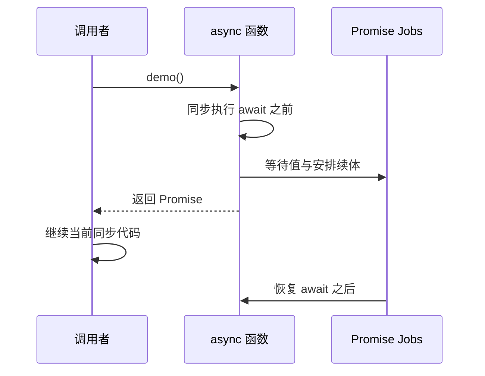

# `await` 暂停的是 async 函数，不是整个 JS 线程

## async 返回一个 Promise

```js
async function f() { return 42; }
const p = f();
console.log(p instanceof Promise); // true
p.then(console.log);              // 后续输出 42
```

`async` 函数即使直接返回普通值，也会返回 Promise；函数体里的同步 `throw` 会使返回 Promise 被拒绝（不会以同样的方式同步抛给普通调用点）。

## await 前后的时间分界

```js
async function demo() {
  console.log('before');
  const value = await Promise.resolve(7);
  console.log('after', value);
}
console.log('start');
demo();
console.log('end');
// start before end after 7
```

`await` 对 Promise/thenable 使用 Promise 机制取得结果，并在异步续体中恢复。即使值已就绪，它也不会让 `after` 插入当前同步栈中。



## 并发和串行不是语法选项，而是依赖关系

```js
// 需要串行：第二步依赖第一步结果
const user = await getUser();
const profile = await getProfile(user.id);

// 两步独立：并发发起，统一等待
const [settings, alerts] = await Promise.all([
  getSettings(), getAlerts()
]);
```

不要以为 `Promise.all` 自己“启动”异步动作：`getSettings()` 和 `getAlerts()` 已经在构造输入数组时被调用。组合 API **管理结果**，不是给 JavaScript 创建线程。

## 异常与调试

```js
try {
  const data = await fetchData();
  return parse(data);
} catch (e) {
  report(e);
  throw e; // 若希望上游知道失败，必须继续抛出
}
```

没有 `throw` 的 catch 会正常返回 `undefined`，使上游看到 fulfilled(undefined)；这是工程中常见的“吞掉错误”。
