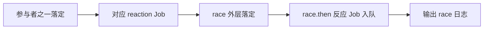

# Promise.race：比的是落定，不是成功

## 先 fulfilled 或先 rejected，谁先落定谁胜出

```js
Promise.race([
  Promise.reject('X'),
  new Promise(resolve => setTimeout(() => resolve('Y'), 10))
]).then(console.log, err => console.log('rejected', err));
// rejected X
```

`Promise.race` 不会为了挑到成功值而忽略拒绝。它常用于超时竞争，但只让组合结果先落定，不会强制停止超时后仍在运行的操作。

## race 与 `.then` 的日志时间不是同一时刻

race 外层 Promise 可以在某个 reaction Job 中落定，用户传给它的 `.then` 回调却要以**另一个 reaction Job** 才执行。因此在日志预测里，不能把 `race` 结果打印当作它真正落定时刻。



## 边界

`Promise.race([])` 返回**永远 pending** 的 Promise。若输入的某个 thenable 在采用过程中需要更多 Job，实际“先落定”由 Job 的调度过程决定，不是简单比较输入数组谁写在前面。

## 超时竞赛的典型误区

```js
const timeout = ms => new Promise((_, reject) =>
  setTimeout(() => reject(new Error('timeout')), ms)
);
const result = Promise.race([fetch('/api/data'), timeout(3000)]);
```

这样写即使超时，原始 fetch 也可能继续进行。正式工程应使用 `AbortController` 并清理 timer，见工程篇。
