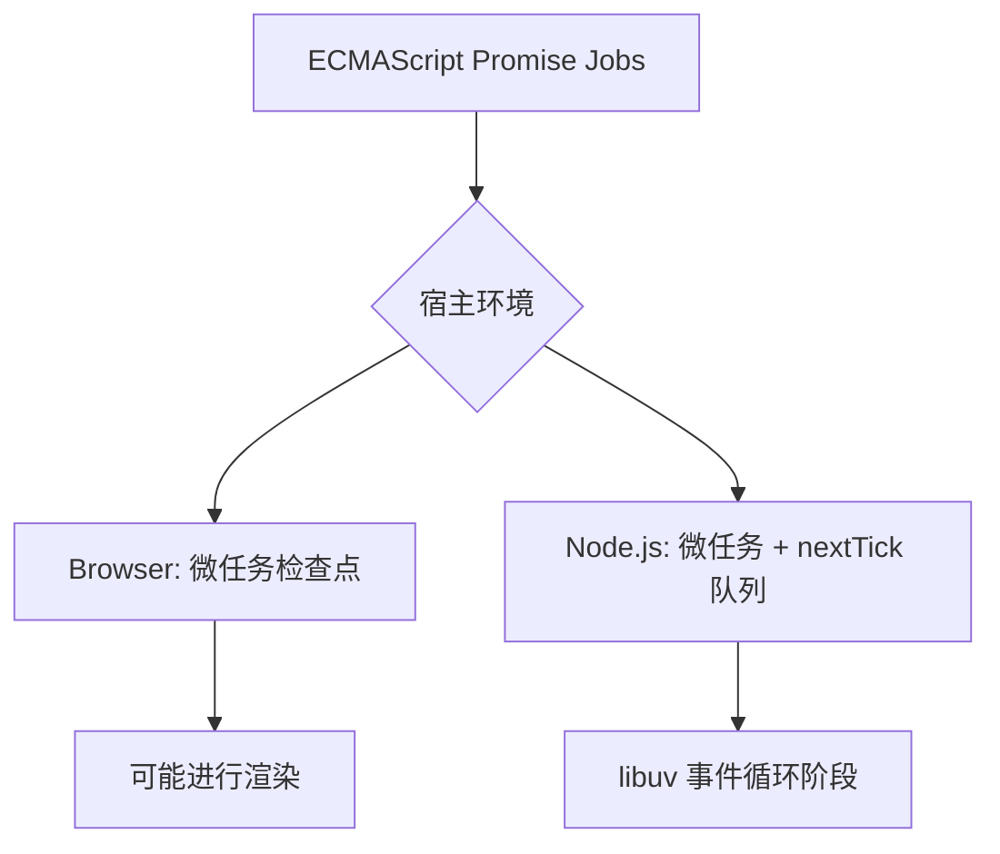

# Promise Jobs 属于语言，事件循环属于宿主

## 三层职责

ECMAScript 规定 Promise 的抽象操作和 Jobs；浏览器的 HTML 事件循环定义 task、微任务检查点和渲染机会；Node.js 在 libuv 和自身运行阶段上额外引入 `process.nextTick()` 等语义。



## 浏览器：微任务可在同一检查点继续生长

```js
queueMicrotask(() => {
  console.log('A');
  queueMicrotask(() => console.log('C'));
});
queueMicrotask(() => console.log('B'));
// A B C
```

因为 A 执行时 C 才入队，B 早已在队首。不断递归入队微任务可能**饿死渲染或延迟其他任务**，不等于“更快”。

## Node.js：CommonJS 与 ESM 不能无条件复用顺序

Node 官方文档指出：在 CJS 顶层执行时，`process.nextTick` 队列通常先于 `queueMicrotask` / Promise microtask 队列；在 ESM 模块顶层，由于模块执行自身已在微任务处理上下文中，示例顺序可不同。

```js
// CommonJS 文件运行时典型顺序（Node 官方示例）：
process.nextTick(() => console.log('tick'));
Promise.resolve().then(() => console.log('promise'));
queueMicrotask(() => console.log('microtask'));
// tick, promise, microtask
```

**重要限制**：具体输出顺序还与调用位置、宿主版本和处于哪个回调阶段有关；不要宣称 “nextTick 永远比所有 Promise 先”。

## 官方来源

- [Node.js process 文档](https://nodejs.org/api/process.html#when-to-use-queuemicrotask-vs-processnexttick)
- [MDN microtask guide](https://developer.mozilla.org/en-US/docs/Web/API/HTML_DOM_API/Microtask_guide)

**实践建议**：浏览器演示使用 `queueMicrotask` + Promise；涉及 `nextTick` 时使用独立 `.cjs` / `.mjs` 文件实验并明确运行环境。
