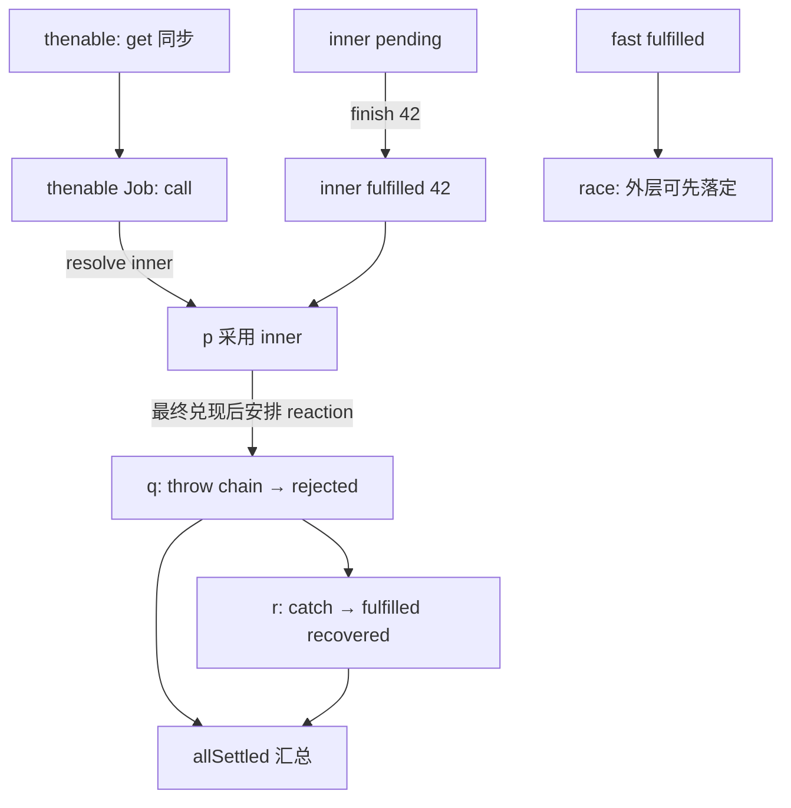

# 综合推演：多个 Promise 的时序不是一条线

下面是课程复盘中反复出现的机制组合：thenable getter、inner 采用、拒绝与 throw 无效、race、allSettled 和微任务嵌套。**此处代码为教学重构，并非历史题目的逐字复刻**。

```js
(() => {
  let finish;
  const inner = new Promise(resolve => { finish = resolve; });
  const thenable = {
    get then() {
      console.log('get');
      return (resolve, reject) => {
        console.log('call');
        resolve(inner);
        reject(new Error('late'));
        throw new Error('thenable-throw');
      };
    }
  };
  console.log('start');
  const p = Promise.resolve(thenable);
  const q = p.then(value => {
    console.log('p', value);
    throw new Error('chain');
  });
  const r = q.catch(e => {
    console.log('catch', e.message);
    return 'recovered';
  });
  Promise.race([p, Promise.resolve('fast')])
    .then(v => console.log('race', v));
  Promise.allSettled([q, r])
    .then(result => console.log('all', result.map(x => x.status).join(',')));
  queueMicrotask(() => {
    console.log('M1');
    finish(42);
    queueMicrotask(() => console.log('M2'));
  });
  console.log('end');
})();
```

## 不猜答案，先画事件模型

**同步阶段**：`inner` executor 保存 `finish`；打印 `start`；`Promise.resolve(thenable)` 同步读取 getter → `get`，然后安排 thenable Job；注册 `q/r/race/allSettled` 相关处理；入队 M1；打印 `end`。

**第一轮 Jobs**：thenable Job 调用 `then` → `call`；`resolve(inner)` 锁定采用，随后 late reject / throw 无法覆盖。独立已 fulfilled 的 `'fast'` 将触发 race 的一条处理流程。M1 使 inner 兑现，随后追加 M2。这些并非都直接让 p 的外部 reaction 即刻执行。

**后续 Jobs**：p 最终兑现 42，q 的回调 `throw chain` 导致拒绝，r.catch 恢复为 `'recovered'`。allSettled 的状态数组应该对应 q 的 rejected、r 的 fulfilled（`rejected,fulfilled`），但相关日志运行时机取决于 reaction Job 入队链条。



## 对照你的历史薄弱点

在过去的复习中，你反复要求分清 **“get 同步，call 异步”“状态落定 ≠ Job 入队 ≠ 回调输出”“resolved 仍可能 pending”**；此题专为这些概念设计。请先推理完整输出序列，再在真实浏览器运行，解释每次微任务入队原因。不能只用答案对错来判定掌握程度。
