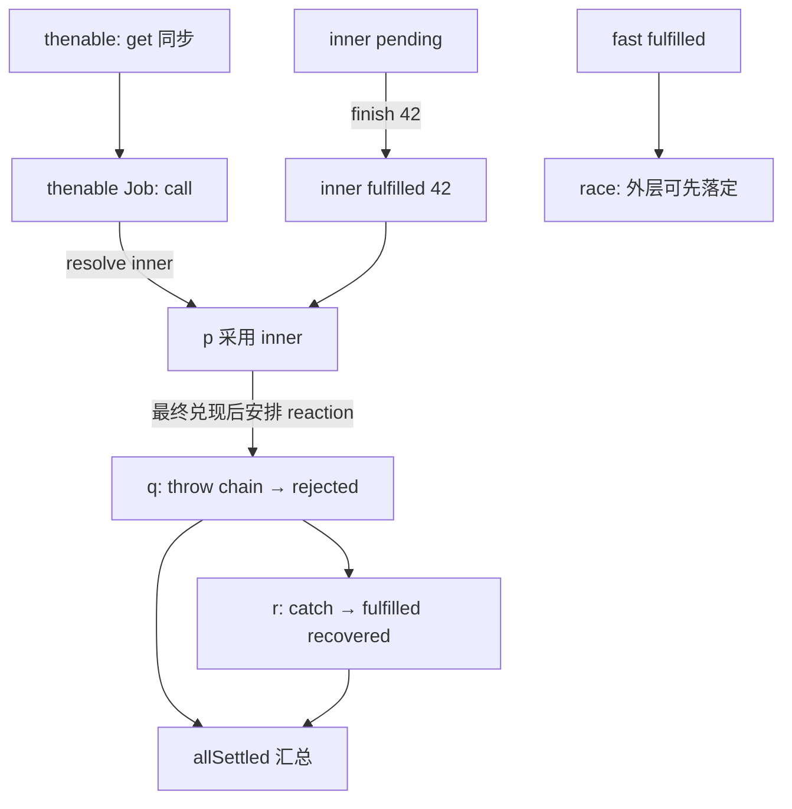

# 综合推演：多个 Promise 的时序不是一条线

下面是课程复盘中反复出现的机制组合：thenable getter、inner 采用、拒绝与 throw 无效、race、allSettled 和微任务嵌套。**此处代码为教学重构，并非历史题目的逐字复刻**。

```js
(() => {
  let finish;
  const inner = new Promise(resolve => { finish = resolve; });
  const thenable = {
    get then() {
      console.log('get');
      return (resolve, reject) => {
        console.log('call');
        resolve(inner);
        reject(new Error('late'));
        throw new Error('thenable-throw');
      };
    }
  };
  console.log('start');
  const p = Promise.resolve(thenable);
  const q = p.then(value => {
    console.log('p', value);
    throw new Error('chain');
  });
  const r = q.catch(e => {
    console.log('catch', e.message);
    return 'recovered';
  });
  Promise.race([p, Promise.resolve('fast')])
    .then(v => console.log('race', v));
  Promise.allSettled([q, r])
    .then(result => console.log('all', result.map(x => x.status).join(',')));
  queueMicrotask(() => {
    console.log('M1');
    finish(42);
    queueMicrotask(() => console.log('M2'));
  });
  console.log('end');
})();
```

## 不猜答案，先画事件模型

先独立预测输出，再展开下面的运行证据。特别注意：`Promise.race` 的 `'fast'` 分支并不是同步打印；它的 reaction Job 在注册时就排入队列，因而会先于后面显式加入的 M1 执行。

<details><summary>展开：Node.js 实测输出与逐轮解释</summary>

在 Node.js v26.10.0 中运行上面的完整代码，输出为：

```text
start
get
end
call
M1
race fast
M2
p 42
catch chain
all rejected,fulfilled
```

**同步阶段**：创建 `inner` 并保存 `finish`；打印 `start`；`Promise.resolve(thenable)` 同步读取 `then` getter，打印 `get`，并安排 thenable Job；随后注册 `p/q/r`、`race` 和 `allSettled` 的 reactions；`race` 遍历到已兑现的 `Promise.resolve('fast')` 时，安排它的 reaction Job；再安排 M1；最后打印 `end`。

**第一轮微任务**：先执行 thenable Job，打印 `call`。`resolve(inner)` 锁定 `p` 的后续命运并开始采用 `inner`；紧随其后的 `reject(...)` 和 throw 都不能覆盖已经锁定的结果。然后执行先前排队的 `'fast'` reaction，打印 `race fast`；再执行 M1，打印 `M1`、调用 `finish(42)`，并把 M2 排到队尾。

**后续微任务**：M1 中调用 `finish(42)` 时，`inner` 已同步转为 fulfilled。随后执行此前排入队列的 inner 采用 Job；它对已兑现的 `inner` 注册反应，并把 `p` 的采用反应 Job 排到 M1 中追加的 M2 后面。因此先打印 `M2`，再经过后续反应 Job 打印 `p 42`。该回调抛出 `chain`，使 `q` 拒绝；`q.catch` 随后打印 `catch chain` 并恢复为 `'recovered'`；最后 `allSettled` 汇总 `q` 与 `r`，打印 `all rejected,fulfilled`。

这条轨迹区分了四件事：同步读取 getter、异步调用 then、Promise 采用链的状态传播、reaction Job 的实际执行。不要把它们统称为“Promise 回调执行”。

</details>



## 对照你的历史薄弱点

在过去的复习中，你反复要求分清 **“get 同步，call 异步”“状态落定 ≠ Job 入队 ≠ 回调输出”“resolved 仍可能 pending”**；此题专为这些概念设计。请先推理完整输出序列，再在真实浏览器运行，解释每次微任务入队原因。不能只用答案对错来判定掌握程度。
