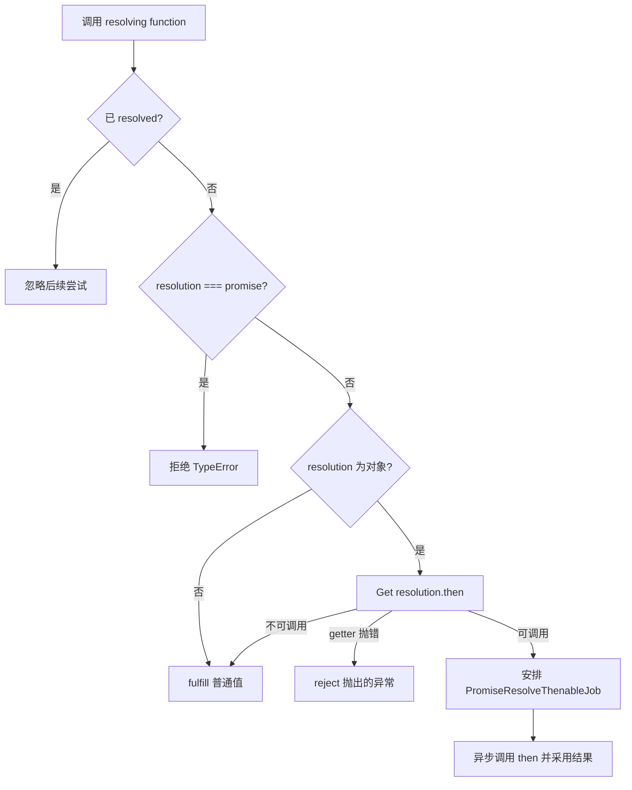

# 规范读法：先辨认“语言规范”与“引擎实现”

本章用于回答一个更深的问题：为什么我们在 JavaScript 里看不到 Promise 的内部状态，却仍能精确解释它的行为？因为 ECMAScript 规范规定了可观察语义。规范里的 `[[PromiseState]]`、`[[PromiseResult]]`、`[[PromiseFulfillReactions]]`、`[[PromiseRejectReactions]]` 等是**抽象内部槽位**，不是可通过普通 JS 属性直接读取的字段。不同引擎可能使用不同内存布局和优化策略，只要遵守规范的可观察效果即可。

## 从 new Promise 到 executor

概念上，构造器会创建带 Promise 内部槽位的对象，创建 resolving functions（包含 resolve/reject 能力），然后**同步**调用 executor。若 executor 同步抛错，并且解决权未被锁定，构造过程会使 Promise 拒绝。一个常见误判是“executor throw 会像普通函数调用一样同步冒泡到创建表达式外部”，但规范中的构造器会捕获它并调用 reject。

```js
const p = new Promise(() => { throw new Error('boom'); });
console.log('still synchronous');
p.catch(e => console.log(e.message));
// still synchronous
// boom
```

## PromiseResolve：区分快捷返回与创建包装

`Promise.resolve(x)` 对某些相同构造器的 Promise 可直接返回 x；对普通值/thenable 则会通过 Promise capability 的解决函数生成一个新的 Promise。关键步骤是取得 `.then` 属性、检查它是否 callable，必要时把 **NewPromiseResolveThenableJob** 入队。



图中的“已 resolved”测试是逻辑解决权守卫，不等价于检查 `[[PromiseState]]` 是否 pending：**两个判断维度不同**。如果外部 Promise 已 resolved to inner，它仍可能 pending，但后续调用同一组 resolving functions 已不起作用。

## FulfillPromise / RejectPromise

两者会更新状态并触发相应 reactions。若已经记录 `.then` handlers，触发会**安排 Job**，而不是在 FulfillPromise 抽象操作内直接调用任意用户 handler。

```js
const p = Promise.resolve(1);
p.then(() => console.log('reaction'));
console.log('sync');
// sync, reaction
```

### Reaction record 与 Promise capability

每次 `.then` 调用通常为新 Promise 创建 capability，并把 fulfilled/rejected 对应的处理器编入 reaction。一个 handler 返回 `x` 时，**不是原 p 的结果直接被改写**，而是通过新 Promise 的 resolving function 处理 x；这正是“每次 then 创建新 Promise”的规范原因。

### PromiseJob 与宿主接口

ECMAScript 规范中有 `HostEnqueuePromiseJob`，宿主决定如何执行 Jobs。浏览器微任务检查点、Node 特有任务队列是宿主概念，不应倒推成引擎内部槽字段。别把 V8 对象 Inspector 展示的 `Promise { <pending> }` 当成可跨环境、可可靠读取的规范 API。

## 实战读规范的路径

按照以下顺序阅读官方章节更高效：

1. `Promise Objects` 状态定义。
2. `CreateResolvingFunctions`、`NewPromiseCapability`。
3. `FulfillPromise`、`RejectPromise`、`PerformPromiseThen`。
4. `NewPromiseResolveThenableJob`、`NewPromiseReactionJob`。
5. `Promise.all/race/any/allSettled` 及对应 PerformPromiseXxx 算法。

参考：[ECMAScript 2026 · Promise Objects](https://tc39.es/ecma262/2026/multipage/control-abstraction-objects.html#sec-promise-objects)。本章是规范语义解释，不试图伪装成 ECMAScript 实现源码。
