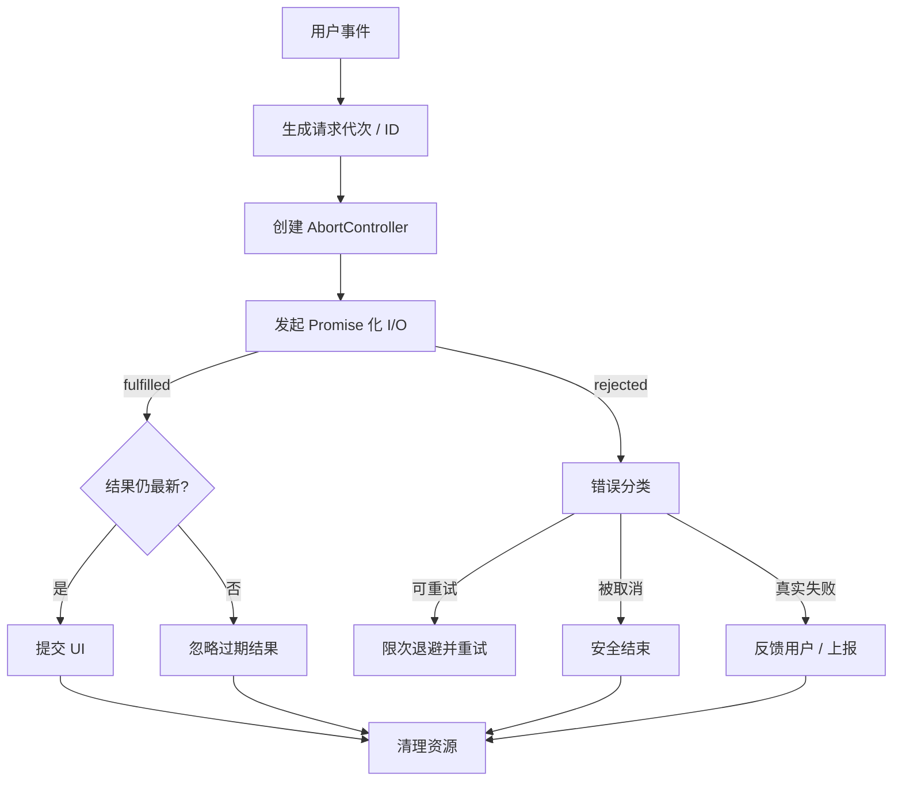

# 将 Promise 原理变成真实项目的可靠性

## 从页面重复请求开始

用户连续输入搜索关键词，前一个请求比后一个更晚返回。即使两次 fetch 都成功，也会发生“旧结果覆盖新结果”。这不是 Promise 自身出了错，而是业务需要规定**哪个结果具有提交 UI 的资格**。

```js
let generation = 0;
let activeController = null;
async function search(query) {
  const mine = ++generation;
  activeController?.abort();
  const controller = new AbortController();
  activeController = controller;
  try {
    const response = await fetch(`/search?q=${encodeURIComponent(query)}`, {
      signal: controller.signal
    });
    if (!response.ok) throw new Error(`HTTP ${response.status}`);
    const rows = await response.json();
    if (mine === generation) render(rows);
  } catch (error) {
    if (mine !== generation) return; // 过期请求不影响新请求 UI
    if (error.name !== 'AbortError') showError(error);
  } finally {
    if (mine === generation) activeController = null;
  }
}
```

上面展示了**取消底层请求 + 校验版本号**两种不同的保护措施。仅 abort 不能保证所有底层任务都能立刻停止；版本号可保护最终 UI 写入。示例依赖页面中已有 `render` 与 `showError` 函数，并非可单独运行的完整应用。

## 有界并发的价值

假设 10,000 个任务：`Promise.all(items.map(run))` 会立即求值 `map` 并创建所有操作，可能造成连接、内存、后端限流压力。应按容量启动一小组任务，某个任务结束后再开始下一项。`Promise.all` 本身不提供队列容量管理。

## 链式操作的所有权边界

- **业务步骤**：应明确是否接受部分成功、是否提供回滚或补偿。
- **HTTP 交互**：应提供取消信号、超时、重试上限、状态码判断。
- **测试**：使用 controlled promises 验证异常分支，而非无限堆叠计时器。
- **监控**：对每次操作关联请求 ID、耗时、完成状态和错误原因；避免敏感数据进入日志。
- **UI**：区分 loading、success、error、cancelled，不把所有 catch 统一渲染成“网络错误”。

## 一张系统流程图



## 完成专题的判定

掌握 Promise 不止是能够背出四种组合 API：你应能把任意故障拆成“触发、对象、结果、解决权、reaction、微任务、底层操作”七个维度，知道什么由语言保证，什么必须交给宿主或业务来保证。至此再去学习复杂 3D Promise 解谜世界，才能明确何处是知识机制、何处是为了游戏体验的可视化隐喻。
