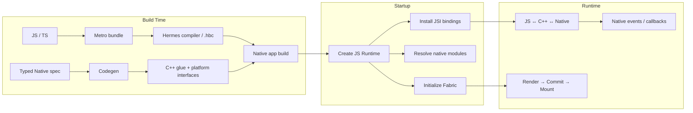

# Build / Startup / Runtime：先建立阶段模型

> 版本基线：React Native 0.88。Build / Startup / Runtime 是帮助定位职责的教学分层，不代表每个步骤都严格串行。

## 一张图先看三阶段

Build 阶段有两条不同的产物路径：Hermes 负责 JavaScript 引擎与字节码；Codegen 根据类型化 Native spec 生成 C++ glue 与平台接口。两者都参与构建，但不是“先 Hermes、再 Codegen”的固定线性链。

Startup 时，已经编译并打包的代码进入运行环境。应用创建 JavaScript Runtime、安装 JSI 绑定、准备 Native Module 访问和 Fabric renderer。模块注册、查找和实例化也不是同一个动作：TurboModule 可以按需初始化。

Runtime 包含 JavaScript 逻辑、JSI 跨语言接口、Native 模块调用、平台事件，以及 Fabric 的 UI 更新。

**诊断口诀：** 字节码和接口脚手架问 Build；Runtime 与模块可用性问 Startup；调用、事件、渲染和帧更新问 Runtime。

## 资料来源
- [Using Hermes](https://reactnative.dev/docs/hermes)
- [What is Codegen?](https://reactnative.dev/docs/the-new-architecture/what-is-codegen)
- [Architecture Overview](https://reactnative.dev/architecture/overview)
