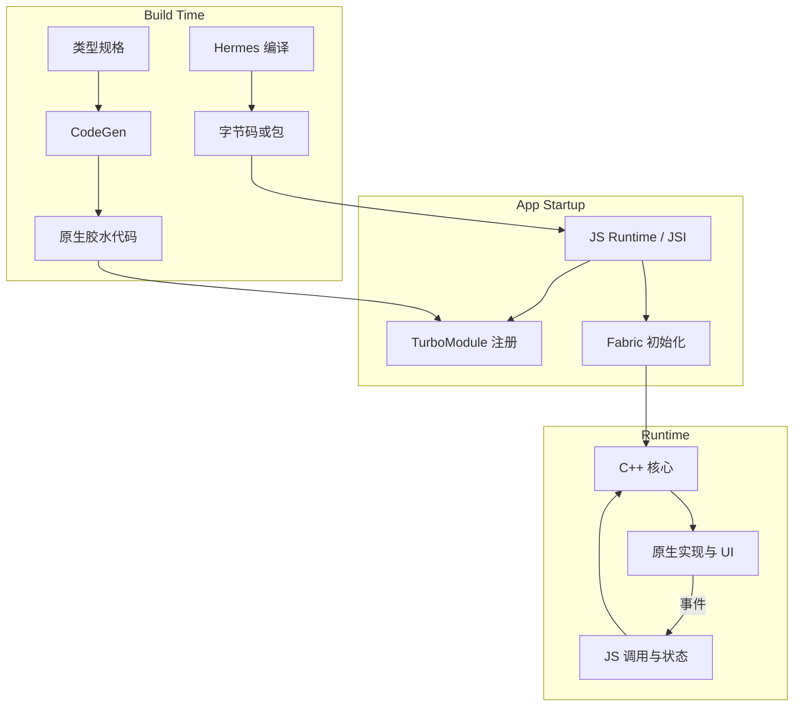

# 构建、启动、运行三阶段

> 来源：按可检索历史会话线索整理，部分表达为知识性归纳，非逐字原话。

将新架构分为 **Build Time / App Startup / Runtime**：构建阶段产生 Hermes 字节码与 CodeGen 生成代码；启动阶段初始化 JS Runtime、JSI 绑定、TurboModule 注册、Fabric；运行阶段贯通 JavaScript、C++ 与平台 Native。

这是概念级全景，不意味着每一步在所有平台上都是线性和同步的。它服务于诊断问题：哪个操作发生在编译期、哪一层持有运行时对象、哪些跨线程边界会引入等待。
