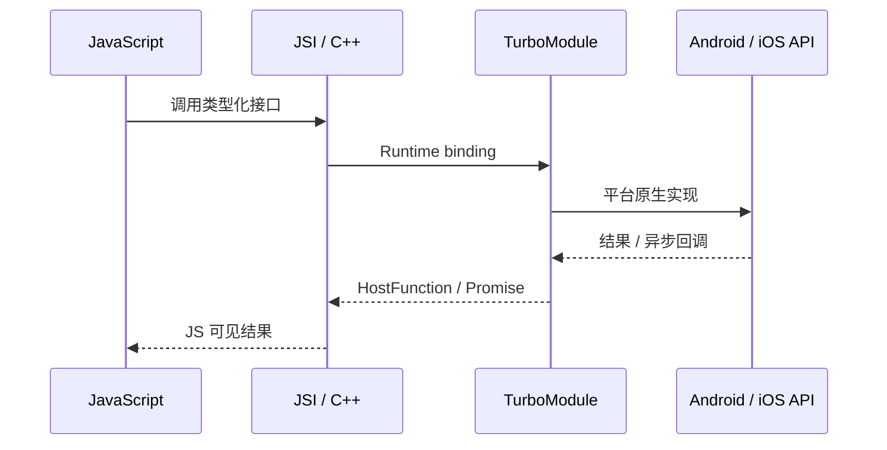

# 四条核心流与 Legacy Bridge 的历史位置

React Native 新架构不能被简化成“JSI 替换 Bridge”。它由多个协作机制组成，学习时要分开追踪不同的数据流。

## A. Native Module 调用流

JSI 是接口能力，不是“一切同步”的保证。具体模块可以暴露同步函数、Promise 或事件订阅；线程与返回语义由 API 决定。

## B. UI 渲染流

Render / Commit / Mount 是 Fabric 主线。Commit 不等于显示像素，Yoga 也不负责创建最终的 UIView 或 Android View。

## C. Native 事件流

平台输入、系统回调和原生组件事件进入 React Native 运行时，再由事件系统调度到 JavaScript 处理器。事件优先级会影响 React 更新如何安排；不能把所有事件都画成单一、同优先级的 FIFO 队列。

## D. 线程与资源生命周期

JavaScript Thread 执行常见 React render 与布局工作；UI Thread 是唯一能够操作平台 Host Views 的线程。Renderer 会根据优先级和场景调度工作，Render 阶段可中断。C++ / HostObject 等对象还涉及引用生命周期与 Runtime 所有权。

## Legacy Bridge 放在哪里？

旧架构常经 Bridge 传递可序列化消息，并存在批量调度和异步边界。New Architecture 以 JSI、TurboModules、Fabric 和 Codegen 改造核心通路；旧 Bridge 适合作为历史对照，不应再当作 React Native 0.88 的默认运行链路。

## 资料来源
- [About the New Architecture](https://reactnative.dev/architecture/landing-page)
- [Threading Model](https://reactnative.dev/architecture/threading-model)
