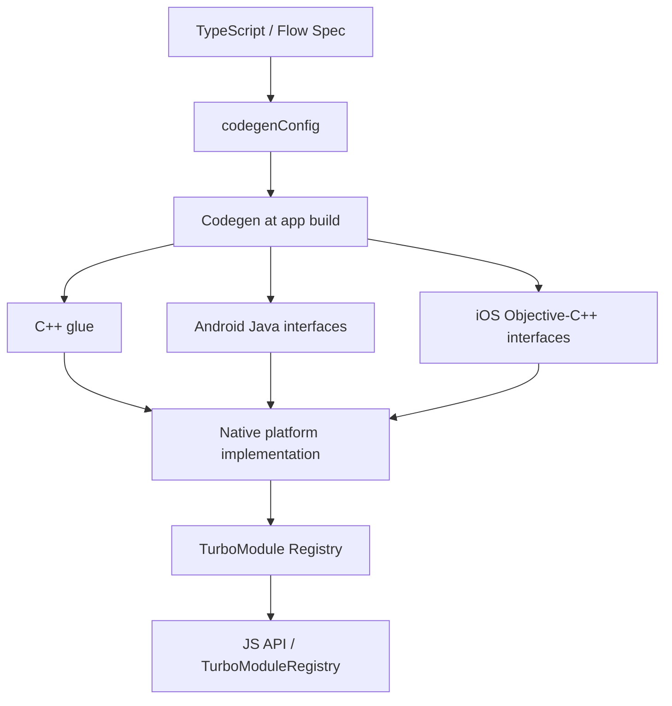

# TurboModules 与 Codegen：从类型契约到原生实现

TurboModule 连接 React Native 应用与平台 Native 能力。Codegen 将类型化接口规格转换为跨语言胶水代码和平台接口。

### 1. 声明 TypeScript / Flow spec

spec 描述 JavaScript 与 Native 之间的方法和数据类型。它是接口契约，不是原生功能本身。

### 2. 配置 Codegen

在 package.json 中声明 codegenConfig，指定模块名称、spec 文件目录、Android package 等。React Native 在构建 Android / iOS 应用时自动运行 Codegen。

### 3. 编写平台原生实现

生成的 C++ glue 与平台接口帮助连接 JS 与原生实现；实际系统 API 调用、权限处理和错误映射仍由 Android / iOS 代码负责。

### 4. 注册并从 JavaScript 访问

模块通过 TurboModule Registry 暴露给 JS。访问模块和创建模块实例不是同一个动作；按需初始化可以减少不必要的启动成本。

## 工程验证清单

1. 修改 TypeScript spec 后，确认 Codegen 找到了 spec 文件。
2. 检查生成接口是否反映最新类型。
3. 确认原生实现满足生成接口。
4. 验证 JS 侧 Registry 名称与 Native 注册名称一致。
5. 在 iOS 与 Android 分别构建和运行。

## 官方资料
- [Native Modules: Introduction](https://reactnative.dev/docs/turbo-native-modules-introduction)
- [What is Codegen?](https://reactnative.dev/docs/the-new-architecture/what-is-codegen)
