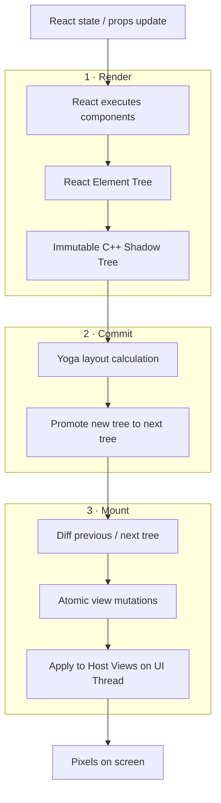

# Fabric：Render / Commit / Mount 的逐帧路径

Fabric 是 React Native 的新渲染系统。理解它最有效的方法，是追踪一次 React state 更新如何变成屏幕上的 Native View 更新。

**Render**：React 执行组件逻辑，得到 React Element Tree。对于 Host Components，Renderer 创建对应 C++ Shadow Nodes 并组织成 Shadow Tree。树是不可变数据结构；更新时通过克隆和结构共享构造新树。

**Commit**：安排 Layout Calculation，并用 Yoga 计算 Shadow Nodes 的位置和大小；随后将新树提升为下一棵待 Mount 的树。

**Mount**：比较上一棵已渲染树和下一棵树，生成创建、更新、删除等原子 mutation，再将它们应用到 Android / iOS Host Views。平台视图操作发生在 UI Thread。

## 三个容易混淆的边界

- Yoga 计算布局，不等于创建最终平台 View。
- Commit 是提交与布局，不代表像素已经绘制。
- Shadow Tree 是 C++ 渲染模型，不是一个个 UIView / android.view.View 的副本。

## 官方资料
- [Fabric](https://reactnative.dev/architecture/fabric-renderer)
- [Render, Commit, and Mount](https://reactnative.dev/architecture/render-pipeline)
