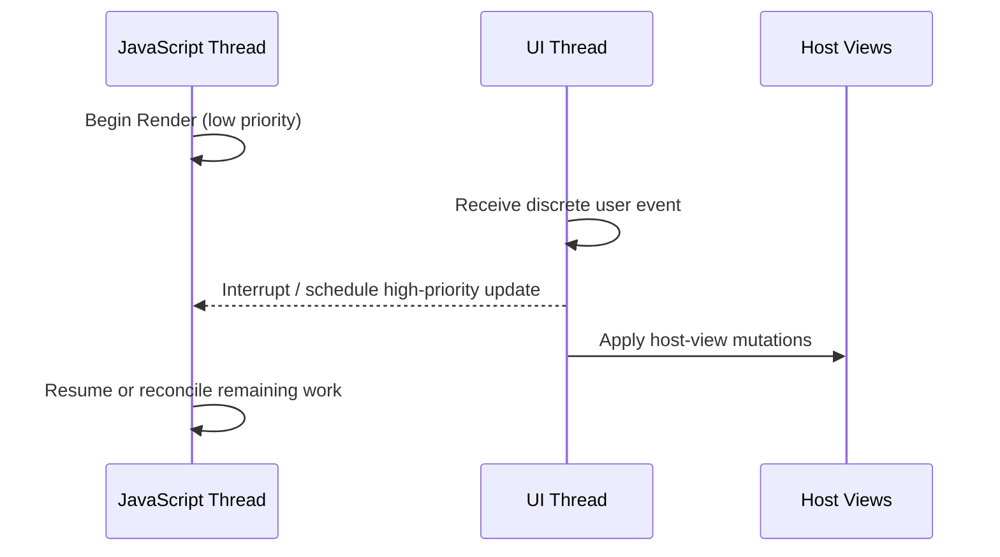

# 线程模型、事件优先级与可中断渲染

React Native Renderer 不是“一条 JS 线程把所有事情做完”。先分清两个关键角色：

- **JavaScript Thread**：执行常见 React render 阶段与布局相关工作。
- **UI Thread（Main Thread）**：唯一能够操作平台 Host Views 的线程。

Render 可能计算很多组件，而用户点击、滚动和手势需要及时响应。New Architecture 的 Renderer 通过不可变数据结构保持线程安全，并允许根据事件优先级选择不同执行场景。

Render 阶段可被中断。当高优先级离散事件到达时，React / Renderer 可以中断当前 Render，并优先处理用户交互。在某些场景中，高优先级 Render 工作可以在 UI Thread 同步执行。

**不要把这句话扩展成“所有 Render 都在 UI Thread”。**常见场景仍是在 JavaScript Thread 执行 Render；线程选择与事件优先级、渲染场景有关。

一些 Host Components 可能由 C++ 或平台层维护不直接暴露给 JavaScript 的状态，例如滚动位置。这样的 C++ State 更新可以跳过 React Render，直接参与 Commit / Mount 相关过程。

## 诊断问题的顺序

1. 是 React state 更新，还是 Native / C++ State 更新？
2. 当前处于 Render、Commit 还是 Mount？
3. 哪条线程拥有当前操作？
4. 是否有高优先级离散事件需要优先响应？
5. 更新是否真正应用到 Host Views？

## 官方资料
- [Threading Model](https://reactnative.dev/architecture/threading-model)
- [Render, Commit, and Mount](https://reactnative.dev/architecture/render-pipeline)
